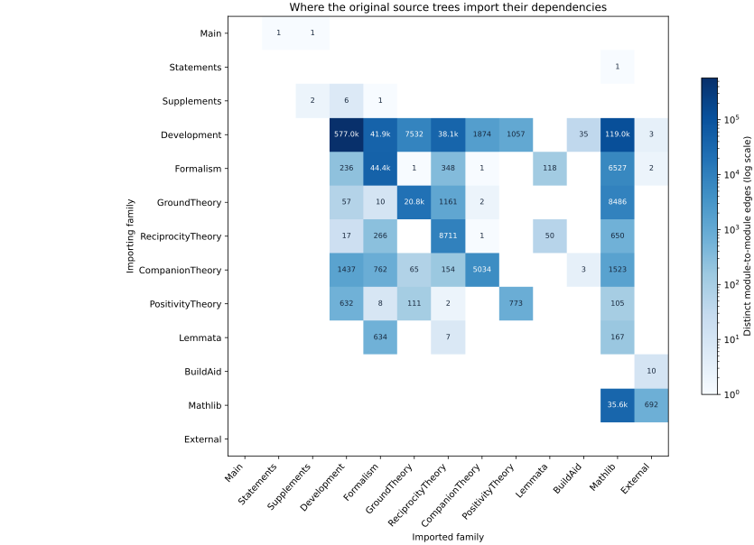

# Structural map of the original Alpöge RH source

The original archive contains **175,187 project modules and 17,374,215 lines**. Every module is reachable from the two imports in [Main.lean](https://github.com/leanprover-community/riemann-hypothesis/blob/40e56bab026552e089d7afcfeff08d2defb9c005/src/Main.lean#L1). To start reading the theorem, follow [riemannHypothesis at line 4](https://github.com/leanprover-community/riemann-hypothesis/blob/40e56bab026552e089d7afcfeff08d2defb9c005/src/Main.lean#L4) to [rhOfAll at line 9](https://github.com/leanprover-community/riemann-hypothesis/blob/40e56bab026552e089d7afcfeff08d2defb9c005/src/Supplements/Kernels/MainTheorems.lean#L9). It applies Formalism.VW.rh_of_every to allChi. This call explains why nonvanishing for every Dirichlet character is a good entry into the much larger argument.

[Jump to the ranked 200](#a-reading-spine-of-200-modules) · [Cross-validation](comparison.md) · [Methods and reproduction](../README.md)

## Source boundary and reachability

| Pinned source tree | Modules | Physical lines | Outside Main | Unreachable lines |
|---|---:|---:|---:|---:|
| Novel | 175,187 | 17,374,215 | 0 (0.00%) | 0 (0.00%) |
| Mathlib | 8,852 | 2,377,849 | 540 (6.10%) | 75,655 (3.18%) |
| Both trees | 184,039 | 19,752,064 | 540 (0.29%) | 75,655 (0.38%) |

Mathlib includes its entire pinned repository, including tests, tooling and archived examples. Reachability measures explicit imports. [All unreachable files](unreachable.tsv.gz).

The adjacency list has 184,307 vertices and 926,017 distinct directed imports. The closure of Main contains 183,747 vertices, including 248 external imports whose internals lie outside these two source trees. [External boundary](external.tsv).

## Depth, hubs and single points of failure

A layer is the maximum import distance from Main, with Main at layer zero. External endpoint names are terminals in the export.

| Graph followed from Main | Edges in longest chain | Layers including Main | Last vertex on one longest chain |
|---|---:|---:|---|
| Project only | 202 | 203 | ReciprocityTheory.ReductiveGroups.ArithmeticGeometry.SemiabelianSchemes.SplitTori.SplitTorusAff |
| Both pinned source trees | 370 | 371 | Mathlib.Tactic.Linter.DirectoryDependency |
| Including external terminals | 371 | 372 | Lean.Elab.AssertExists |

All three paths begin with Main → Supplements.Kernels.MainTheoremsAll → Supplements.Kernels.MainTheoremsCritical → Supplements.Kernels.MainTheorems → Development.AutomorphicArithmetic.CharacterBoxes.MainConclusion. The source-only path ends in Mathlib’s linter infrastructure. A long import chain can measure tool dependencies as well as mathematical prerequisites. [All path vertices](longest-paths.json).

Dependents count distinct direct importers. Imports count distinct direct dependencies. A cut counts other novel modules that become unreachable when the indicated vertex is deleted.

| Metric | Module | Count |
|---|---|---:|
| Fan-out · novel dependents | [Development.AbelianVarietyTheory.Definitions.Divisors.CTSmallCone](https://github.com/leanprover-community/riemann-hypothesis/blob/40e56bab026552e089d7afcfeff08d2defb9c005/src/Development/AbelianVarietyTheory/Definitions/Divisors/CTSmallCone.lean) | 3,088 |
| Fan-out · novel dependents | [Development.AbelianVarietyTheory.Definitions.Divisors.SiegelWeilAnisotropicHermitian](https://github.com/leanprover-community/riemann-hypothesis/blob/40e56bab026552e089d7afcfeff08d2defb9c005/src/Development/AbelianVarietyTheory/Definitions/Divisors/SiegelWeilAnisotropicHermitian.lean) | 2,972 |
| Fan-out · novel dependents | [Development.AbelianVarietyTheory.Definitions.Divisors.DiscreteSeriesHermitianUnique](https://github.com/leanprover-community/riemann-hypothesis/blob/40e56bab026552e089d7afcfeff08d2defb9c005/src/Development/AbelianVarietyTheory/Definitions/Divisors/DiscreteSeriesHermitianUnique.lean) | 2,518 |
| Fan-out · novel dependents | [Development.AbelianVarietyTheory.PublishedTheorems.AutomorphicForms₂.ExistsNormLeHeightPow](https://github.com/leanprover-community/riemann-hypothesis/blob/40e56bab026552e089d7afcfeff08d2defb9c005/src/Development/AbelianVarietyTheory/PublishedTheorems/AutomorphicForms₂/ExistsNormLeHeightPow.lean) | 2,426 |
| Fan-in · novel imports | [Formalism.HermitianCurvature.HeisenbergConjugationMeasurePreserving](https://github.com/leanprover-community/riemann-hypothesis/blob/40e56bab026552e089d7afcfeff08d2defb9c005/src/Formalism/HermitianCurvature/HeisenbergConjugationMeasurePreserving.lean) | 370 |
| Fan-in · novel imports | [GroundTheory.HeightsAndTheta.Heights.ComplexAnalyticSets.Assembly](https://github.com/leanprover-community/riemann-hypothesis/blob/40e56bab026552e089d7afcfeff08d2defb9c005/src/GroundTheory/HeightsAndTheta/Heights/ComplexAnalyticSets/Assembly.lean) | 320 |
| Fan-in · novel imports | [Development.AutomorphicArithmetic.IntegralCasts.CapelliIdentities.CapelliComplements.KappaIntegralBound](https://github.com/leanprover-community/riemann-hypothesis/blob/40e56bab026552e089d7afcfeff08d2defb9c005/src/Development/AutomorphicArithmetic/IntegralCasts/CapelliIdentities/CapelliComplements/KappaIntegralBound.lean) | 275 |
| Fan-in · novel imports | [GroundTheory.HeightsAndTheta.Heights.HilbertSamuel.AssemblyBase](https://github.com/leanprover-community/riemann-hypothesis/blob/40e56bab026552e089d7afcfeff08d2defb9c005/src/GroundTheory/HeightsAndTheta/Heights/HilbertSamuel/AssemblyBase.lean) | 231 |
| Removal cut · novel losses | [Supplements.Kernels.MainTheoremsAll](https://github.com/leanprover-community/riemann-hypothesis/blob/40e56bab026552e089d7afcfeff08d2defb9c005/src/Supplements/Kernels/MainTheoremsAll.lean) | 175,184 |
| Removal cut · novel losses | [Development.AutomorphicArithmetic.Foundations.GaloisRepresentations.IntegralStructures.RowSrc](https://github.com/leanprover-community/riemann-hypothesis/blob/40e56bab026552e089d7afcfeff08d2defb9c005/src/Development/AutomorphicArithmetic/Foundations/GaloisRepresentations/IntegralStructures/RowSrc.lean) | 13,054 |
| Removal cut · novel losses | [Development.AutomorphicArithmetic.Foundations.GaloisRepresentations.IntegralStructures.GaloisRepresentationsOfThetaLift](https://github.com/leanprover-community/riemann-hypothesis/blob/40e56bab026552e089d7afcfeff08d2defb9c005/src/Development/AutomorphicArithmetic/Foundations/GaloisRepresentations/IntegralStructures/GaloisRepresentationsOfThetaLift.lean) | 12,271 |
| Removal cut · novel losses | [Development.AutomorphicArithmetic.Foundations.GaloisRepresentations.IntegralStructures.GeometricFlagBases.WeightOneGeometricRealization](https://github.com/leanprover-community/riemann-hypothesis/blob/40e56bab026552e089d7afcfeff08d2defb9c005/src/Development/AutomorphicArithmetic/Foundations/GaloisRepresentations/IntegralStructures/GeometricFlagBases/WeightOneGeometricRealization.lean) | 10,801 |

In the full closure, Mathlib leads both degree tables with 136,003 direct dependents and 8,313 direct imports. The largest project cut is an import-only file, MainTheoremsAll. Its architectural importance and its lack of a declaration illustrate why the reading spine requires separate declaration evidence. [Full metrics](metrics.tsv.gz).

## Where the project code concentrates

| Original directory or file | Modules | Lines | Share of original lines |
|---|---:|---:|---:|
| src/Development | 141,928 | 12,232,663 | 70.4% |
| src/Formalism | 18,254 | 3,200,748 | 18.4% |
| src/GroundTheory | 8,507 | 1,119,138 | 6.4% |
| src/ReciprocityTheory | 3,845 | 563,016 | 3.2% |
| src/CompanionTheory | 2,027 | 194,218 | 1.1% |
| src/PositivityTheory | 449 | 55,130 | 0.3% |
| src/Lemmata | 167 | 9,232 | 0.1% |
| src/Supplements | 3 | 22 | 0.0% |
| src/BuildAid | 5 | 20 | 0.0% |
| src/Statements.lean | 1 | 16 | 0.0% |
| src/Main.lean | 1 | 12 | 0.0% |

Of 175,187 novel files, **136,003** import Mathlib directly (77.6%). Only **269** name a specific Mathlib submodule. The 485 distinct project-to-specific-Mathlib edges break down as follows. Counts measure explicit import choices.

RingTheory (150), Analysis (88), NumberTheory (44), LinearAlgebra (39), Topology (33), AlgebraicGeometry (33), Algebra (31), FieldTheory (14), MeasureTheory (12), GroupTheory (10), Data (10), CategoryTheory (8), RepresentationTheory (5), Tactic (4), Geometry (3), Combinatorics (1).

## Communities

The project-only graph divides into 94 import communities (Louvain modularity 0.861). The largest groups below combine their dominant directory with the strongest explicit Mathlib area evidence. One or two imports give weak evidence for an area label.

| Community | Dominant directory | Novel modules | Novel lines | Specific Mathlib edges by area |
|---:|---|---:|---:|---|
| 1 | Development.AbelianVarietyTheory | 17,836 | 1,599,144 | RingTheory (15), AlgebraicGeometry (13), Algebra (3) |
| 2 | GroundTheory.HeightsAndTheta | 11,539 | 1,095,335 | Analysis (4), RingTheory (3), MeasureTheory (2) |
| 3 | Development.AbelianVarietyTheory | 10,979 | 917,294 | Analysis (2), AlgebraicGeometry (1) |
| 4 | Development.AbelianVarietyTheory | 8,962 | 786,970 | No area-specific import |
| 5 | Development.AbelianVarietyTheory | 8,576 | 1,366,574 | Analysis (27), MeasureTheory (7), Algebra (3) |
| 6 | Development.AbelianVarietyTheory | 7,593 | 724,608 | Analysis (12), RepresentationTheory (1) |
| 7 | Development.AbelianVarietyTheory | 7,331 | 778,263 | Algebra (1), RingTheory (1) |
| 8 | Development.AbelianVarietyTheory | 7,232 | 610,880 | No area-specific import |
| 9 | Development.AutomorphicArithmetic | 6,640 | 703,167 | RingTheory (68), NumberTheory (26), Topology (21) |
| 10 | Development.AbelianVarietyTheory | 6,395 | 584,736 | Analysis (2), RingTheory (2), NumberTheory (1) |
| 11 | Development.AbelianVarietyTheory | 6,098 | 615,719 | RingTheory (17), Analysis (3), NumberTheory (3) |
| 12 | Development.AbelianVarietyTheory | 6,025 | 417,916 | No area-specific import |

The two source trees together give 81 communities (modularity 0.735). The Mathlib umbrella concentrates most of its source tree in one group. The five groups with the most project source lines are below. IDs refer to this second partition.

| Combined group | Novel modules | Mathlib-tree modules | Novel lines | Largest project directory |
|---:|---:|---:|---:|---|
| 1 | 18,221 | 8,824 | 1,706,753 | Development.AbelianVarietyTheory |
| 5 | 8,993 | 0 | 1,406,346 | Development.AbelianVarietyTheory |
| 2 | 14,807 | 0 | 1,366,598 | Development.AbelianVarietyTheory |
| 3 | 13,261 | 0 | 1,219,012 | Development.AbelianVarietyTheory |
| 13 | 5,340 | 0 | 831,620 | Development.AbelianVarietyTheory |

## What the RH traces establish

Starting at the single riemannHypothesis declaration, the lexical resolver finds 641,100 named source sites across 134,176 project files. Each retained reference has an identifier spelling, a caller line and a visible candidate definition. The scan covers types and bodies. Tactic alternatives, implicit arguments, notation and local shadowing can cause divergences in either direction from elaborated proof terms. [Method details](../README.md) · [All traced sites](rh-trace.tsv.gz).

## A reading spine of 200 modules

Read down the table for a balance of widely imported foundations and modules that guard large branches. Each source link opens the selected declaration in the original archive. The two numbers in the impact column are direct project dependents and other project modules disconnected by removal. The evidence column links to the literal reference in its caller and gives the number of explicit source steps from RH. The complete line-by-line chains are in [spine-witnesses.json.gz](spine-witnesses.json.gz).

| Priority | Import rank | File and starting line | Dependents / cut | RH source evidence | What to read here |
|---:|---:|---|---:|---|---|
| 1 | 688 | [src/Development/AutomorphicArithmetic/Foundations/GaloisRepresentations/IntegralStructures/RowSrc.lean:6](https://github.com/leanprover-community/riemann-hypothesis/blob/40e56bab026552e089d7afcfeff08d2defb9c005/src/Development/AutomorphicArithmetic/Foundations/GaloisRepresentations/IntegralStructures/RowSrc.lean#L6) | 2 / 13054 | [UpperTheory.Gal.Int.galoisLocalGlobalStrong_recParameter](https://github.com/leanprover-community/riemann-hypothesis/blob/40e56bab026552e089d7afcfeff08d2defb9c005/src/Development/AutomorphicArithmetic/CharacterBoxes/MainConclusion.lean#L11) · 4 steps | Applies theta lifting to obtain the local–global existence and compatibility theorem for Galois representations used in Dirichlet L-function nonvanishing. |
| 2 | 850 | [src/Development/AutomorphicArithmetic/Foundations/GaloisRepresentations/IntegralStructures/GaloisRepresentationsOfThetaLift.lean:6](https://github.com/leanprover-community/riemann-hypothesis/blob/40e56bab026552e089d7afcfeff08d2defb9c005/src/Development/AutomorphicArithmetic/Foundations/GaloisRepresentations/IntegralStructures/GaloisRepresentationsOfThetaLift.lean#L6) | 1 / 12271 | [galoisRepresentations_of_thetaLift](https://github.com/leanprover-community/riemann-hypothesis/blob/40e56bab026552e089d7afcfeff08d2defb9c005/src/Development/AutomorphicArithmetic/Foundations/GaloisRepresentations/IntegralStructures/RowSrc.lean#L6) · 5 steps | Derives the local–global Galois parameter from a theta lift and the weight-one geometric realization. |
| 3 | 1 | [src/Formalism/LocalRingCardinality/RhoDetPrimeEqMuTildeMulChiPow.lean:28](https://github.com/leanprover-community/riemann-hypothesis/blob/40e56bab026552e089d7afcfeff08d2defb9c005/src/Formalism/LocalRingCardinality/RhoDetPrimeEqMuTildeMulChiPow.lean#L28) | 921 / 0 | [Formalism.BasicNotions.Loc.GoodCoef](https://github.com/leanprover-community/riemann-hypothesis/blob/40e56bab026552e089d7afcfeff08d2defb9c005/src/Development/AbelianVarietyTheory/Definitions/AutomorphicMembership/NStageTrivialCharacterCoeffEq.lean#L30) · 10 steps | Defines the coefficient-field condition that captures roots of unity of order dividing lcm(ℓ,N). |
| 4 | 899 | [src/Development/AutomorphicArithmetic/Foundations/GaloisRepresentations/IntegralStructures/GeometricFlagBases/WeightOneGeometricRealization.lean:11](https://github.com/leanprover-community/riemann-hypothesis/blob/40e56bab026552e089d7afcfeff08d2defb9c005/src/Development/AutomorphicArithmetic/Foundations/GaloisRepresentations/IntegralStructures/GeometricFlagBases/WeightOneGeometricRealization.lean#L11) | 1 / 10801 | [UpperTheory.Gal.Int.Geo.geoOne_holds](https://github.com/leanprover-community/riemann-hypothesis/blob/40e56bab026552e089d7afcfeff08d2defb9c005/src/Development/AutomorphicArithmetic/Foundations/GaloisRepresentations/IntegralStructures/GaloisRepresentationsOfThetaLift.lean#L6) · 6 steps | Turns the weight-one realization into the geometric input consumed by the theta-lift argument. |
| 5 | 2 | [src/ReciprocityTheory/ReductiveGroups/ArithmeticGeometry/BirationalGeometry/ToroidalCompactification/UniformisationConclusion.lean:83](https://github.com/leanprover-community/riemann-hypothesis/blob/40e56bab026552e089d7afcfeff08d2defb9c005/src/ReciprocityTheory/ReductiveGroups/ArithmeticGeometry/BirationalGeometry/ToroidalCompactification/UniformisationConclusion.lean#L83) | 2390 / 0 | [PELUnif](https://github.com/leanprover-community/riemann-hypothesis/blob/40e56bab026552e089d7afcfeff08d2defb9c005/src/Development/AbelianVarietyTheory/PublishedTheorems/AutomorphicForms₂/ToroidalChartsForFan.lean#L19) · 9 steps | Packages PEL uniformisation data, including degeneration data, an integral action and a polarized abelian variety over the fraction field. |
| 6 | 907 | [src/Development/AutomorphicArithmetic/Foundations/GaloisRepresentations/IntegralStructures/GeometricFlagBases/GeometricRealizationOfWeightOne.lean:25](https://github.com/leanprover-community/riemann-hypothesis/blob/40e56bab026552e089d7afcfeff08d2defb9c005/src/Development/AutomorphicArithmetic/Foundations/GaloisRepresentations/IntegralStructures/GeometricFlagBases/GeometricRealizationOfWeightOne.lean#L25) | 1 / 10429 | [geometric_realization_of_weight_one](https://github.com/leanprover-community/riemann-hypothesis/blob/40e56bab026552e089d7afcfeff08d2defb9c005/src/Development/AutomorphicArithmetic/Foundations/GaloisRepresentations/IntegralStructures/GeometricFlagBases/WeightOneGeometricRealization.lean#L11) · 7 steps | Assembles the weight-one geometric realization using a holomorphic Lefschetz formula and a Kodaira–Spencer implication. |
| 7 | 3 | [src/Development/AbelianVarietyTheory/Definitions/Divisors/CTSmallCone.lean:62](https://github.com/leanprover-community/riemann-hypothesis/blob/40e56bab026552e089d7afcfeff08d2defb9c005/src/Development/AbelianVarietyTheory/Definitions/Divisors/CTSmallCone.lean#L62) | 3088 / 0 | [latHat](https://github.com/leanprover-community/riemann-hypothesis/blob/40e56bab026552e089d7afcfeff08d2defb9c005/src/Development/AutomorphicArithmetic/Foundations/GaloisRepresentations/ThetaParseval/ThetaKernels/Stab2CptK.lean#L59) · 8 steps | Defines the closed adelic subgroup generated from an integral lattice and introduces stabilizer conditions for the theta model. |
| 8 | 822 | [src/Development/AutomorphicArithmetic/AutomorphicVarieties/ModularityArgument/ThresholdArguments/DenseThresholdCases/TopMainZj.lean:71](https://github.com/leanprover-community/riemann-hypothesis/blob/40e56bab026552e089d7afcfeff08d2defb9c005/src/Development/AutomorphicArithmetic/AutomorphicVarieties/ModularityArgument/ThresholdArguments/DenseThresholdCases/TopMainZj.lean#L71) | 2 / 8049 | [UpperTheory.One.Join.automorphic_window_of_inputs](https://github.com/leanprover-community/riemann-hypothesis/blob/40e56bab026552e089d7afcfeff08d2defb9c005/src/Development/AutomorphicArithmetic/AutomorphicVarieties/ModularityArgument/ThresholdArguments/DenseThresholdCases/VwinOfRow.lean#L5) · 6 steps | Derives the automorphic window from open-image, isobaric base-change and Galois hypotheses. |
| 9 | 5 | [src/Development/AbelianVarietyTheory/BlockTheory/DivisorBase/WeilTensorModels.lean:114](https://github.com/leanprover-community/riemann-hypothesis/blob/40e56bab026552e089d7afcfeff08d2defb9c005/src/Development/AbelianVarietyTheory/BlockTheory/DivisorBase/WeilTensorModels.lean#L114) | 1307 / 0 | [HasExp](https://github.com/leanprover-community/riemann-hypothesis/blob/40e56bab026552e089d7afcfeff08d2defb9c005/src/Development/AutomorphicArithmetic/Foundations/GaloisRepresentations/ThetaParseval/HalfIndexLattices/TLiftK.lean#L20) · 7 steps | Specifies the exponents of the archimedean character in a Weil tensor model. |
| 10 | 1117 | [src/Development/AutomorphicArithmetic/AutomorphicVarieties/ModularityArgument/ThresholdArguments/DenseThresholdCases/WindowBoundOfLiteratureLevel.lean:33](https://github.com/leanprover-community/riemann-hypothesis/blob/40e56bab026552e089d7afcfeff08d2defb9c005/src/Development/AutomorphicArithmetic/AutomorphicVarieties/ModularityArgument/ThresholdArguments/DenseThresholdCases/WindowBoundOfLiteratureLevel.lean#L33) | 1 / 7919 | [_root_.UpperTheory.V.v_window_of_literal_automorphy_n](https://github.com/leanprover-community/riemann-hypothesis/blob/40e56bab026552e089d7afcfeff08d2defb9c005/src/Development/AutomorphicArithmetic/AutomorphicVarieties/ModularityArgument/ThresholdArguments/DenseThresholdCases/TopMainZj.lean#L58) · 8 steps | Derives the window bound from the rank-N automorphy hypothesis via the descent and vanishing reduction. |
| 11 | 6 | [src/ReciprocityTheory/ReductiveGroups/ArithmeticGeometry/ExtensionDescent/SecBaseChangeAnySt.lean:16](https://github.com/leanprover-community/riemann-hypothesis/blob/40e56bab026552e089d7afcfeff08d2defb9c005/src/ReciprocityTheory/ReductiveGroups/ArithmeticGeometry/ExtensionDescent/SecBaseChangeAnySt.lean#L16) | 1340 / 0 | [Out.SecBaseChangeAnySt](https://github.com/leanprover-community/riemann-hypothesis/blob/40e56bab026552e089d7afcfeff08d2defb9c005/src/Development/AbelianVarietyTheory/Proofs/ModuliProofs/PushforwardPolarisationBundleInvertibleOnModel.lean#L24) · 10 steps | Formulates local existence of bases of sections of positive line-bundle powers compatible with base change. |
| 12 | 7 | [src/ReciprocityTheory/ReductiveGroups/ArithmeticGeometry/ExtensionDescent/GlobalSectionsRankAlgClosed.lean:19](https://github.com/leanprover-community/riemann-hypothesis/blob/40e56bab026552e089d7afcfeff08d2defb9c005/src/ReciprocityTheory/ReductiveGroups/ArithmeticGeometry/ExtensionDescent/GlobalSectionsRankAlgClosed.lean#L19) | 713 / 0 | [Out.GlobalSectionsRankAlgClosed](https://github.com/leanprover-community/riemann-hypothesis/blob/40e56bab026552e089d7afcfeff08d2defb9c005/src/Development/AbelianVarietyTheory/Proofs/ModuliProofs/PushforwardPolarisationBundleInvertibleOnModel.lean#L25) · 10 steps | States the dimension law for sections of powers of a polarization over an algebraically closed field. |
| 13 | 8 | [src/ReciprocityTheory/ReductiveGroups/ArithmeticGeometry/ExtensionDescent/UnifUniqSt.lean:60](https://github.com/leanprover-community/riemann-hypothesis/blob/40e56bab026552e089d7afcfeff08d2defb9c005/src/ReciprocityTheory/ReductiveGroups/ArithmeticGeometry/ExtensionDescent/UnifUniqSt.lean#L60) | 2284 / 0 | [Laws6](https://github.com/leanprover-community/riemann-hypothesis/blob/40e56bab026552e089d7afcfeff08d2defb9c005/src/Development/AbelianVarietyTheory/Proofs/UniformizationProofs/AllSixAbelianSchemeLawsHold.lean#L22) · 10 steps | Packages uniqueness of uniformisation as a named law used by the geometric constructions. |
| 14 | 9 | [src/Formalism/SatakeDualWeyl/Statement.lean:17](https://github.com/leanprover-community/riemann-hypothesis/blob/40e56bab026552e089d7afcfeff08d2defb9c005/src/Formalism/SatakeDualWeyl/Statement.lean#L17) | 120 / 0 | [Formalism.UG.hform](https://github.com/leanprover-community/riemann-hypothesis/blob/40e56bab026552e089d7afcfeff08d2defb9c005/src/Development/WeilBound/ThetaLifts/FrameEstimates/SiegelAll.lean#L238) · 9 steps | Defines the matrix Hermitian form by a double sum and develops identities for conjugate transpose. |
| 15 | 10 | [src/ReciprocityTheory/ReductiveGroups/ArithmeticGeometry/BirationalGeometry/ToroidalCompactification/IsHolPeriods.lean:22](https://github.com/leanprover-community/riemann-hypothesis/blob/40e56bab026552e089d7afcfeff08d2defb9c005/src/ReciprocityTheory/ReductiveGroups/ArithmeticGeometry/BirationalGeometry/ToroidalCompactification/IsHolPeriods.lean#L22) | 1206 / 0 | [IsHolTo](https://github.com/leanprover-community/riemann-hypothesis/blob/40e56bab026552e089d7afcfeff08d2defb9c005/src/Development/AutomorphicSpectrum/PublishedTheorems/Geometry₂/GagaSections.lean#L13) · 10 steps | Defines holomorphic maps to a complex scheme by testing local sections for differentiability on open inverse images. |
| 16 | 1402 | [src/Supplements/Kernels/MainTheorems.lean:9](https://github.com/leanprover-community/riemann-hypothesis/blob/40e56bab026552e089d7afcfeff08d2defb9c005/src/Supplements/Kernels/MainTheorems.lean#L9) | 1 / 4478 | [rhOfAll](https://github.com/leanprover-community/riemann-hypothesis/blob/40e56bab026552e089d7afcfeff08d2defb9c005/src/Main.lean#L4) · 1 steps | Applies the every-character nonvanishing result to obtain Mathlib’s Riemann Hypothesis. |
| 17 | 1392 | [src/Development/AutomorphicArithmetic/CharacterBoxes/MainConclusion.lean:10](https://github.com/leanprover-community/riemann-hypothesis/blob/40e56bab026552e089d7afcfeff08d2defb9c005/src/Development/AutomorphicArithmetic/CharacterBoxes/MainConclusion.lean#L10) | 1 / 4473 | [UpperTheory.FinalTheorems.everyCharacter](https://github.com/leanprover-community/riemann-hypothesis/blob/40e56bab026552e089d7afcfeff08d2defb9c005/src/Supplements/Kernels/MainTheorems.lean#L7) · 3 steps | Feeds the local–global Galois parameter into the final theorem for every Dirichlet character. |
| 18 | 13 | [src/Development/AbelianVarietyTheory/Definitions/Divisors/DivisorSupportCondition.lean:105](https://github.com/leanprover-community/riemann-hypothesis/blob/40e56bab026552e089d7afcfeff08d2defb9c005/src/Development/AbelianVarietyTheory/Definitions/Divisors/DivisorSupportCondition.lean#L105) | 858 / 0 | [GlobalTheory.EtC.C2](https://github.com/leanprover-community/riemann-hypothesis/blob/40e56bab026552e089d7afcfeff08d2defb9c005/src/Development/AbelianVarietyTheory/Proofs/DivisorProofs/SmoothAffineCurveEtaleCohomologicalDimensionLeOn.lean#L9) · 13 steps | Formulates cohomological vanishing as a subsingleton condition over affine Dedekind schemes in degrees at least two. |
| 19 | 1430 | [src/Development/AutomorphicArithmetic/ThetaCorrespondence/ThetaPairLifts/ThirdPlaceSeries/EveryCharacterOfLiteratureOfVWin.lean:810](https://github.com/leanprover-community/riemann-hypothesis/blob/40e56bab026552e089d7afcfeff08d2defb9c005/src/Development/AutomorphicArithmetic/ThetaCorrespondence/ThetaPairLifts/ThirdPlaceSeries/EveryCharacterOfLiteratureOfVWin.lean#L810) | 1 / 4471 | [UpperTheory.LiteratureTheorems.every_character_of_literature_of_vWin](https://github.com/leanprover-community/riemann-hypothesis/blob/40e56bab026552e089d7afcfeff08d2defb9c005/src/Development/AutomorphicArithmetic/CharacterBoxes/MainConclusion.lean#L8) · 5 steps | Combines the literature hypotheses with the automorphic window to obtain the every-character conclusion. |
| 20 | 14 | [src/Formalism/SharpRestriction/Divisibility/SchurIrreducible.lean:375](https://github.com/leanprover-community/riemann-hypothesis/blob/40e56bab026552e089d7afcfeff08d2defb9c005/src/Formalism/SharpRestriction/Divisibility/SchurIrreducible.lean#L375) | 377 / 0 | [Formalism.MainNotions.SchurIrreducible.wittIdx](https://github.com/leanprover-community/riemann-hypothesis/blob/40e56bab026552e089d7afcfeff08d2defb9c005/src/Development/AbelianVarietyTheory/PublishedTheorems/TwistedTraceFormula/WeilSiegelFormulaUnitary.lean#L58) · 9 steps | Defines the Witt index as the supremum of dimensions of totally isotropic subspaces. |
| 21 | 1564 | [src/Development/AutomorphicArithmetic/ThetaCorrespondence/ThetaPairLifts/ThirdPlaceSeries/SiegelEisensteinSecondTermHypotheses.lean:69](https://github.com/leanprover-community/riemann-hypothesis/blob/40e56bab026552e089d7afcfeff08d2defb9c005/src/Development/AutomorphicArithmetic/ThetaCorrespondence/ThetaPairLifts/ThirdPlaceSeries/SiegelEisensteinSecondTermHypotheses.lean#L69) | 1 / 3936 | [_root_.UpperTheory.Lit.every_character_of_theta_integrals_local_matching](https://github.com/leanprover-community/riemann-hypothesis/blob/40e56bab026552e089d7afcfeff08d2defb9c005/src/Development/AutomorphicArithmetic/ThetaCorrespondence/ThetaPairLifts/ThirdPlaceSeries/EveryCharacterOfLiteratureOfVWin.lean#L811) · 6 steps | Combines theta-integral agreement, local matching, covolume and window hypotheses to derive the every-character theorem. |
| 22 | 15 | [src/Formalism/LocalRingCardinality/AdicCompletionLocal/LocTied.lean:11](https://github.com/leanprover-community/riemann-hypothesis/blob/40e56bab026552e089d7afcfeff08d2defb9c005/src/Formalism/LocalRingCardinality/AdicCompletionLocal/LocTied.lean#L11) | 776 / 0 | [LocTied](https://github.com/leanprover-community/riemann-hypothesis/blob/40e56bab026552e089d7afcfeff08d2defb9c005/src/Development/AutomorphicArithmetic/Foundations/GaloisRepresentations/TypeConditions/WeightsConjBis.lean#L64) · 7 steps | Identifies the abstract local period rings with crystalline and de Rham period rings by explicit isomorphisms. |
| 23 | 16 | [src/Development/AbelianVarietyTheory/PublishedTheorems/AutomorphicForms₂/ExistsNormLeHeightPow.lean:28](https://github.com/leanprover-community/riemann-hypothesis/blob/40e56bab026552e089d7afcfeff08d2defb9c005/src/Development/AbelianVarietyTheory/PublishedTheorems/AutomorphicForms₂/ExistsNormLeHeightPow.lean#L28) | 2426 / 0 | [GlobalTheory.Published.CuspRapidDecay](https://github.com/leanprover-community/riemann-hypothesis/blob/40e56bab026552e089d7afcfeff08d2defb9c005/src/Development/AutomorphicArithmetic/ThetaCorrespondence/ThetaPairLifts/ThirdPlaceSeries/BernsteinUnitaryProductIrreducible.lean#L31) · 8 steps | States rapid decay for cuspidal automorphic functions under smoothness and growth hypotheses. |
| 24 | 1586 | [src/Development/AutomorphicSpectrum/Proofs/GeometryProofs/FinalTheoremOfInputsRightStatement.lean:19](https://github.com/leanprover-community/riemann-hypothesis/blob/40e56bab026552e089d7afcfeff08d2defb9c005/src/Development/AutomorphicSpectrum/Proofs/GeometryProofs/FinalTheoremOfInputsRightStatement.lean#L19) | 1 / 3741 | [GlobalTheory.T.final_theorem_of_inputs_right](https://github.com/leanprover-community/riemann-hypothesis/blob/40e56bab026552e089d7afcfeff08d2defb9c005/src/Development/WeilBound/CoreStatements/AutomorphicKernels/MoriwakiBigness/HilbertSamuelApplications/GoodTowerVolumeTheoremBis.lean#L18) · 10 steps | Exposes the reduced geometric, height and comparison hypotheses entering the final tower argument. |
| 25 | 17 | [src/ReciprocityTheory/ReductiveGroups/ArithmeticGeometry/BirationalGeometry/ToroidalCompactification/PushInvertible.lean:29](https://github.com/leanprover-community/riemann-hypothesis/blob/40e56bab026552e089d7afcfeff08d2defb9c005/src/ReciprocityTheory/ReductiveGroups/ArithmeticGeometry/BirationalGeometry/ToroidalCompactification/PushInvertible.lean#L29) | 172 / 0 | [Moduli](https://github.com/leanprover-community/riemann-hypothesis/blob/40e56bab026552e089d7afcfeff08d2defb9c005/src/Development/AbelianVarietyTheory/PublishedTheorems/Divisors₂/ToroidalCompactificationBis.lean#L48) · 8 steps | Specifies the smooth quasi-projective moduli scheme, its relative dimension and its universal object at a given level. |
| 26 | 1583 | [src/Development/AutomorphicSpectrum/Proofs/GeometryProofs/FinalTheoremOfInputsRight.lean:28](https://github.com/leanprover-community/riemann-hypothesis/blob/40e56bab026552e089d7afcfeff08d2defb9c005/src/Development/AutomorphicSpectrum/Proofs/GeometryProofs/FinalTheoremOfInputsRight.lean#L28) | 1 / 3740 | [GlobalTheory.CompanionTheory.Ar.Top.goodTower_volume_of_reduced](https://github.com/leanprover-community/riemann-hypothesis/blob/40e56bab026552e089d7afcfeff08d2defb9c005/src/Development/AutomorphicSpectrum/Proofs/GeometryProofs/FinalTheoremOfInputsRightStatement.lean#L20) · 11 steps | Assembles the reduced toroidal and arithmetic hypotheses used to obtain the good tower and its volume theorem. |
| 27 | 18 | [src/ReciprocityTheory/ReductiveGroups/ArithmeticGeometry/ExtensionDescent/NonzeroLocus.lean:33](https://github.com/leanprover-community/riemann-hypothesis/blob/40e56bab026552e089d7afcfeff08d2defb9c005/src/ReciprocityTheory/ReductiveGroups/ArithmeticGeometry/ExtensionDescent/NonzeroLocus.lean#L33) | 55 / 0 | [Out.RelAmple](https://github.com/leanprover-community/riemann-hypothesis/blob/40e56bab026552e089d7afcfeff08d2defb9c005/src/Development/AutomorphicSpectrum/PublishedTheorems/Algebra₂/ZarhinStatement.lean#L25) · 8 steps | Defines relative ampleness via affine nonvanishing loci of sections of a positive power of a line bundle. |
| 28 | 1773 | [src/Development/AutomorphicSpectrum/Proofs/DivisibilityProofs/GoodTowerVolumeTheoremStatement.lean:26](https://github.com/leanprover-community/riemann-hypothesis/blob/40e56bab026552e089d7afcfeff08d2defb9c005/src/Development/AutomorphicSpectrum/Proofs/DivisibilityProofs/GoodTowerVolumeTheoremStatement.lean#L26) | 1 / 2934 | [GlobalTheory.T.good_tower_volume_theorem](https://github.com/leanprover-community/riemann-hypothesis/blob/40e56bab026552e089d7afcfeff08d2defb9c005/src/Development/AutomorphicSpectrum/Proofs/GeometryProofs/FinalTheoremOfInputsRight.lean#L39) · 12 steps | States the tower-and-volume implication from integrability, avoidance, Weil and positivity hypotheses. |
| 29 | 19 | [src/ReciprocityTheory/ReductiveGroups/ArithmeticGeometry/BirationalGeometry/ToroidalCompactification/ThetaUnifAV.lean:10](https://github.com/leanprover-community/riemann-hypothesis/blob/40e56bab026552e089d7afcfeff08d2defb9c005/src/ReciprocityTheory/ReductiveGroups/ArithmeticGeometry/BirationalGeometry/ToroidalCompactification/ThetaUnifAV.lean#L10) | 676 / 0 | [lbPow](https://github.com/leanprover-community/riemann-hypothesis/blob/40e56bab026552e089d7afcfeff08d2defb9c005/src/Development/AbelianVarietyTheory/PublishedTheorems/AutomorphicForms₂/SiegelToroidalIntegral.lean#L153) · 8 steps | Introduces line-bundle powers and Hermitian forms for the holomorphic uniformisation construction. |
| 30 | 1772 | [src/Development/AutomorphicSpectrum/Proofs/DivisibilityProofs/GoodTowerVolumeTheorem.lean:36](https://github.com/leanprover-community/riemann-hypothesis/blob/40e56bab026552e089d7afcfeff08d2defb9c005/src/Development/AutomorphicSpectrum/Proofs/DivisibilityProofs/GoodTowerVolumeTheorem.lean#L36) | 1 / 2933 | [GlobalTheory.CompanionTheory.Ar.Top.goodTower_and_volume](https://github.com/leanprover-community/riemann-hypothesis/blob/40e56bab026552e089d7afcfeff08d2defb9c005/src/Development/AutomorphicSpectrum/Proofs/DivisibilityProofs/GoodTowerVolumeTheoremStatement.lean#L27) · 13 steps | Derives the joint existence of a good tower and its volume formula from the listed inputs. |
| 31 | 20 | [src/ReciprocityTheory/ReductiveGroups/ArithmeticGeometry/BirationalGeometry/ToroidalCompactification/IsGrpPullback.lean:14](https://github.com/leanprover-community/riemann-hypothesis/blob/40e56bab026552e089d7afcfeff08d2defb9c005/src/ReciprocityTheory/ReductiveGroups/ArithmeticGeometry/BirationalGeometry/ToroidalCompactification/IsGrpPullback.lean#L14) | 236 / 0 | [abLocus](https://github.com/leanprover-community/riemann-hypothesis/blob/40e56bab026552e089d7afcfeff08d2defb9c005/src/Development/AbelianVarietyTheory/PublishedTheorems/AutomorphicForms₂/SiegelToroidalIntegral.lean#L151) · 8 steps | Defines the abelian locus of a family by testing properness after geometric base change. |
| 32 | 1658 | [src/Development/AutomorphicArithmetic/AutomorphicVarieties/ModularityArgument/KatoQuadraticCharacters/UnramifiedZeta/ZetaUr.lean:9](https://github.com/leanprover-community/riemann-hypothesis/blob/40e56bab026552e089d7afcfeff08d2defb9c005/src/Development/AutomorphicArithmetic/AutomorphicVarieties/ModularityArgument/KatoQuadraticCharacters/UnramifiedZeta/ZetaUr.lean#L9) | 2 / 2046 | [Final.zetaUr](https://github.com/leanprover-community/riemann-hypothesis/blob/40e56bab026552e089d7afcfeff08d2defb9c005/src/Development/AutomorphicArithmetic/AutomorphicVarieties/ModularityArgument/KatoQuadraticCharacters/SphericalDecomposition/SphAtTw.lean#L19) · 14 steps | Assembles the unramified zeta-class law from smoothed Kato classes, integrality and Hodge–Tate input. |
| 33 | 1413 | [src/Development/AbelianVarietyTheory/Proofs/DivisorProofs/ToroidalCompactificationFanLogKodairaSpencerIso.lean:8](https://github.com/leanprover-community/riemann-hypothesis/blob/40e56bab026552e089d7afcfeff08d2defb9c005/src/Development/AbelianVarietyTheory/Proofs/DivisorProofs/ToroidalCompactificationFanLogKodairaSpencerIso.lean#L8) | 3 / 1941 | [GlobalTheory.TorKSField.toroidalForFanKS](https://github.com/leanprover-community/riemann-hypothesis/blob/40e56bab026552e089d7afcfeff08d2defb9c005/src/Development/AutomorphicArithmetic/ThetaCorrespondence/ThetaPairLifts/ThirdPlaceSeries/EveryCharacterOfLiteratureOfVWin.lean#L524) · 7 steps | Obtains the fan-dependent toroidal Kodaira–Spencer statement from rigid boundary charts for the unitary datum. |
| 34 | 21 | [src/ReciprocityTheory/ReductiveGroups/ArithmeticGeometry/SemiabelianSchemes/AbelianSchemeQuotients/IsAbelianScheme.lean:13](https://github.com/leanprover-community/riemann-hypothesis/blob/40e56bab026552e089d7afcfeff08d2defb9c005/src/ReciprocityTheory/ReductiveGroups/ArithmeticGeometry/SemiabelianSchemes/AbelianSchemeQuotients/IsAbelianScheme.lean#L13) | 93 / 0 | [IsAbelianScheme](https://github.com/leanprover-community/riemann-hypothesis/blob/40e56bab026552e089d7afcfeff08d2defb9c005/src/Development/AutomorphicSpectrum/PublishedTheorems/Algebra₂/ZarhinStatement.lean#L25) · 8 steps | Defines an abelian scheme through commutativity, smoothness, properness and geometric connectedness. |
| 35 | 2142 | [src/Development/AutomorphicArithmetic/ThetaCorrespondence/ThetaPairLifts/ThirdPlaceSeries/HypothesesNonemptyOfUnramifiedExponents.lean:41](https://github.com/leanprover-community/riemann-hypothesis/blob/40e56bab026552e089d7afcfeff08d2defb9c005/src/Development/AutomorphicArithmetic/ThetaCorrespondence/ThetaPairLifts/ThirdPlaceSeries/HypothesesNonemptyOfUnramifiedExponents.lean#L41) | 1 / 1853 | [_root_.GlobalTheory.Fc.S0.StageU.hypotheses_nonempty_of_unramified_exponents_alt](https://github.com/leanprover-community/riemann-hypothesis/blob/40e56bab026552e089d7afcfeff08d2defb9c005/src/Development/AutomorphicArithmetic/ThetaCorrespondence/ThetaPairLifts/ThirdPlaceSeries/SiegelEisensteinSecondTermHypotheses.lean#L68) · 8 steps | Builds the definite-side existence implication using unramified-exponent bounds and linked families of local conditions. |
| 36 | 23 | [src/ReciprocityTheory/ReductiveGroups/ArithmeticGeometry/BirationalGeometry/ToroidalCompactification/HeckeKer.lean:10](https://github.com/leanprover-community/riemann-hypothesis/blob/40e56bab026552e089d7afcfeff08d2defb9c005/src/ReciprocityTheory/ReductiveGroups/ArithmeticGeometry/BirationalGeometry/ToroidalCompactification/HeckeKer.lean#L10) | 1429 / 0 | [N1ab](https://github.com/leanprover-community/riemann-hypothesis/blob/40e56bab026552e089d7afcfeff08d2defb9c005/src/Development/AutomorphicSpectrum/Definitions/DivisibilityTowers/GoodOrigin.lean#L68) · 10 steps | States existence of a moduli object at each level for positive-dimensional CM data. |
| 37 | 24 | [src/Development/AbelianVarietyTheory/Definitions/Foundations/MatrixMeasurableSpace.lean:27](https://github.com/leanprover-community/riemann-hypothesis/blob/40e56bab026552e089d7afcfeff08d2defb9c005/src/Development/AbelianVarietyTheory/Definitions/Foundations/MatrixMeasurableSpace.lean#L27) | 83 / 0 | [GlobalTheory.SplitWeil.KOne](https://github.com/leanprover-community/riemann-hypothesis/blob/40e56bab026552e089d7afcfeff08d2defb9c005/src/Development/AutomorphicArithmetic/Foundations/LocalLanglands/IsRecTOfIsRec.lean#L71) · 7 steps | Defines the first congruence subgroup as the image of the kernel of reduction on integral matrices. |
| 38 | 25 | [src/Formalism/SatakeDualWeyl/KpqSubgroupCompact.lean:517](https://github.com/leanprover-community/riemann-hypothesis/blob/40e56bab026552e089d7afcfeff08d2defb9c005/src/Formalism/SatakeDualWeyl/KpqSubgroupCompact.lean#L517) | 321 / 5 | [Formalism.UG.Final.DwActMul](https://github.com/leanprover-community/riemann-hypothesis/blob/40e56bab026552e089d7afcfeff08d2defb9c005/src/Formalism/LocalRingCardinality/RankBoundMonotoneInDimension.lean#L894) · 10 steps | Proves the multiplicativity law for the named unitary-group action. |
| 39 | 26 | [src/ReciprocityTheory/ReductiveGroups/ArithmeticGeometry/BirationalGeometry/ToroidalCompactification/Clauses.lean:16](https://github.com/leanprover-community/riemann-hypothesis/blob/40e56bab026552e089d7afcfeff08d2defb9c005/src/ReciprocityTheory/ReductiveGroups/ArithmeticGeometry/BirationalGeometry/ToroidalCompactification/Clauses.lean#L16) | 327 / 0 | [SiegPre](https://github.com/leanprover-community/riemann-hypothesis/blob/40e56bab026552e089d7afcfeff08d2defb9c005/src/Development/AbelianVarietyTheory/Definitions/ModuliSpaces/IsSeparatedOfIsQProjOver.lean#L28) · 9 steps | Packages the abelian scheme, group structure and line-bundle data for the preliminary Siegel construction. |
| 40 | 27 | [src/ReciprocityTheory/ReductiveGroups/ArithmeticGeometry/BirationalGeometry/ToroidalCompactification/ValCalc.lean:23](https://github.com/leanprover-community/riemann-hypothesis/blob/40e56bab026552e089d7afcfeff08d2defb9c005/src/ReciprocityTheory/ReductiveGroups/ArithmeticGeometry/BirationalGeometry/ToroidalCompactification/ValCalc.lean#L23) | 621 / 0 | [gs_unit](https://github.com/leanprover-community/riemann-hypothesis/blob/40e56bab026552e089d7afcfeff08d2defb9c005/src/Development/AbelianVarietyTheory/Definitions/ThetaMetrics/MemNonzeroLocusIffPowFn.lean#L275) · 10 steps | Shows that evaluating an invertible local section agrees with evaluating its underlying section. |
| 41 | 28 | [src/Formalism/SharpRestriction/LevelLetterCocycles/DataNLoc.lean:527](https://github.com/leanprover-community/riemann-hypothesis/blob/40e56bab026552e089d7afcfeff08d2defb9c005/src/Formalism/SharpRestriction/LevelLetterCocycles/DataNLoc.lean#L527) | 188 / 0 | [LocPrime](https://github.com/leanprover-community/riemann-hypothesis/blob/40e56bab026552e089d7afcfeff08d2defb9c005/src/Development/AutomorphicArithmetic/Foundations/GaloisRepresentations/TypeConditions/WeightsConjBis.lean#L64) · 7 steps | Collects the period rings, Galois actions and period data attached to a prime ℓ. |
| 42 | 29 | [src/ReciprocityTheory/ReductiveGroups/ArithmeticGeometry/BirationalGeometry/ToroidalCompactification/TwoWeightEqOneAddRoot.lean:14](https://github.com/leanprover-community/riemann-hypothesis/blob/40e56bab026552e089d7afcfeff08d2defb9c005/src/ReciprocityTheory/ReductiveGroups/ArithmeticGeometry/BirationalGeometry/ToroidalCompactification/TwoWeightEqOneAddRoot.lean#L14) | 61 / 0 | [Host](https://github.com/leanprover-community/riemann-hypothesis/blob/40e56bab026552e089d7afcfeff08d2defb9c005/src/Development/AbelianVarietyTheory/PublishedTheorems/Divisors₂/ToroidalCompactificationBis.lean#L46) · 8 steps | Specifies a CM host containing a square root of minus a prime congruent to seven modulo sixteen. |
| 43 | 30 | [src/Formalism/SharpRestriction/CuspSpanNormBounds/RelevantZeroGramTerms.lean:16](https://github.com/leanprover-community/riemann-hypothesis/blob/40e56bab026552e089d7afcfeff08d2defb9c005/src/Formalism/SharpRestriction/CuspSpanNormBounds/RelevantZeroGramTerms.lean#L16) | 201 / 0 | [umat](https://github.com/leanprover-community/riemann-hypothesis/blob/40e56bab026552e089d7afcfeff08d2defb9c005/src/Development/AbelianVarietyTheory/PublishedTheorems/AutomorphicForms₂/FormalDegreeCompactDualIff.lean#L14) · 9 steps | Extracts the underlying complex matrix of a unitary group element for representation-theoretic constructions. |
| 44 | 31 | [src/ReciprocityTheory/ReductiveGroups/ArithmeticGeometry/BirationalGeometry/ToroidalCompactification/IsLieBasis.lean:67](https://github.com/leanprover-community/riemann-hypothesis/blob/40e56bab026552e089d7afcfeff08d2defb9c005/src/ReciprocityTheory/ReductiveGroups/ArithmeticGeometry/BirationalGeometry/ToroidalCompactification/IsLieBasis.lean#L67) | 173 / 0 | [valAt'](https://github.com/leanprover-community/riemann-hypothesis/blob/40e56bab026552e089d7afcfeff08d2defb9c005/src/Development/AutomorphicSpectrum/Proofs/GlobalProofs/GagaSections.lean#L113) · 9 steps | Defines evaluation of a section at a complex point, used in the subsequent holomorphic uniformisation data. |
| 45 | 2438 | [src/Development/AutomorphicSpectrum/Proofs/DivisibilityProofs/VolumeTheoremOfInputsStatement.lean:23](https://github.com/leanprover-community/riemann-hypothesis/blob/40e56bab026552e089d7afcfeff08d2defb9c005/src/Development/AutomorphicSpectrum/Proofs/DivisibilityProofs/VolumeTheoremOfInputsStatement.lean#L23) | 1 / 1394 | [GlobalTheory.T.volume_theorem_of_inputs](https://github.com/leanprover-community/riemann-hypothesis/blob/40e56bab026552e089d7afcfeff08d2defb9c005/src/Development/AutomorphicSpectrum/Proofs/DivisibilityProofs/GoodTowerVolumeTheorem.lean#L49) · 14 steps | States how the Hodge-lattice, flag, comparison and twisting inputs imply the volume theorem. |
| 46 | 32 | [src/Formalism/LocalToGlobal/BesselHermitianTheta/DefsReal.lean:64](https://github.com/leanprover-community/riemann-hypothesis/blob/40e56bab026552e089d7afcfeff08d2defb9c005/src/Formalism/LocalToGlobal/BesselHermitianTheta/DefsReal.lean#L64) | 105 / 0 | [HasParam](https://github.com/leanprover-community/riemann-hypothesis/blob/40e56bab026552e089d7afcfeff08d2defb9c005/src/Development/AbelianVarietyTheory/PublishedTheorems/AutomorphicForms₂/DiscreteSeriesCoverExistsIff.lean#L11) · 9 steps | Characterizes a representation parameter by the existence and minimality of a highest weight. |
| 47 | 2423 | [src/Development/AutomorphicSpectrum/Proofs/DivisibilityProofs/VolumeTheoremOfInputs.lean:72](https://github.com/leanprover-community/riemann-hypothesis/blob/40e56bab026552e089d7afcfeff08d2defb9c005/src/Development/AutomorphicSpectrum/Proofs/DivisibilityProofs/VolumeTheoremOfInputs.lean#L72) | 1 / 1393 | [GlobalTheory.CompanionTheory.Ar.Cusp.volumeTheoremX_of_inputs](https://github.com/leanprover-community/riemann-hypothesis/blob/40e56bab026552e089d7afcfeff08d2defb9c005/src/Development/AutomorphicSpectrum/Proofs/DivisibilityProofs/VolumeTheoremOfInputsStatement.lean#L24) · 15 steps | Derives the volume theorem from integrability, Weil, Hodge-lattice and comparison hypotheses. |
| 48 | 2246 | [src/Development/AutomorphicArithmetic/Foundations/GaloisRepresentations/IntegralStructures/Development.lean:18](https://github.com/leanprover-community/riemann-hypothesis/blob/40e56bab026552e089d7afcfeff08d2defb9c005/src/Development/AutomorphicArithmetic/Foundations/GaloisRepresentations/IntegralStructures/Development.lean#L18) | 1 / 1331 | [recT](https://github.com/leanprover-community/riemann-hypothesis/blob/40e56bab026552e089d7afcfeff08d2defb9c005/src/Development/AutomorphicArithmetic/Foundations/GaloisRepresentations/IntegralStructures/RowSrc.lean#L6) · 5 steps | Identifies the local reciprocity predicate supplied to the Galois representation argument. |
| 49 | 33 | [src/Formalism/LocalRingCardinality/DataTies.lean:38](https://github.com/leanprover-community/riemann-hypothesis/blob/40e56bab026552e089d7afcfeff08d2defb9c005/src/Formalism/LocalRingCardinality/DataTies.lean#L38) | 281 / 0 | [Ties](https://github.com/leanprover-community/riemann-hypothesis/blob/40e56bab026552e089d7afcfeff08d2defb9c005/src/Formalism/SharpRestriction/ParConsts.lean#L46) · 10 steps | Records the conditions tying the abstract scale, signature and row definitions to a single datum. |
| 50 | 34 | [src/Development/AbelianVarietyTheory/Definitions/TwistedInnerProducts/IsSubquotientDetRepParInd.lean:640](https://github.com/leanprover-community/riemann-hypothesis/blob/40e56bab026552e089d7afcfeff08d2defb9c005/src/Development/AbelianVarietyTheory/Definitions/TwistedInnerProducts/IsSubquotientDetRepParInd.lean#L640) | 190 / 0 | [isCuspidal_detRep_one](https://github.com/leanprover-community/riemann-hypothesis/blob/40e56bab026552e089d7afcfeff08d2defb9c005/src/Development/AbelianVarietyTheory/Definitions/NonGaloisDescent/NonemptyEquivMultiProdOne.lean#L308) · 7 steps | Proves cuspidality of the one-dimensional determinant representation attached to a smooth character. |
| 51 | 2435 | [src/Development/AbelianVarietyTheory/Proofs/SatakeParameters/BundleBothPartsOfStandardKernelOfGlobalArtinReciStatement.lean:7](https://github.com/leanprover-community/riemann-hypothesis/blob/40e56bab026552e089d7afcfeff08d2defb9c005/src/Development/AbelianVarietyTheory/Proofs/SatakeParameters/BundleBothPartsOfStandardKernelOfGlobalArtinReciStatement.lean#L7) | 1 / 1308 | [GlobalTheory.T.bundle_bothParts_of_standardKernel_of_globalArtinReciprocity](https://github.com/leanprover-community/riemann-hypothesis/blob/40e56bab026552e089d7afcfeff08d2defb9c005/src/Development/AutomorphicArithmetic/ThetaCorrespondence/ThetaPairLifts/ThirdPlaceSeries/ServHRowLinkR.lean#L17) · 14 steps | States how global Artin reciprocity upgrades a row of standard kernel data to the bundled row required downstream. |
| 52 | 35 | [src/ReciprocityTheory/ReductiveGroups/ArithmeticGeometry/ExtensionDescent/QkToAkU.lean:16](https://github.com/leanprover-community/riemann-hypothesis/blob/40e56bab026552e089d7afcfeff08d2defb9c005/src/ReciprocityTheory/ReductiveGroups/ArithmeticGeometry/ExtensionDescent/QkToAkU.lean#L16) | 635 / 0 | [QkToAkU](https://github.com/leanprover-community/riemann-hypothesis/blob/40e56bab026552e089d7afcfeff08d2defb9c005/src/ReciprocityTheory/ReductiveGroups/ArithmeticGeometry/ExtensionDescent/OLinBaseChangeSt.lean#L71) · 12 steps | Defines compatibility between a degeneration point and a point of an abelian variety for each generating line-bundle identification. |
| 53 | 2381 | [src/Development/AbelianVarietyTheory/Proofs/SatakeParameters/BundleBothPartsOfStandardKernelOfGlobalArtinReci.lean:15](https://github.com/leanprover-community/riemann-hypothesis/blob/40e56bab026552e089d7afcfeff08d2defb9c005/src/Development/AbelianVarietyTheory/Proofs/SatakeParameters/BundleBothPartsOfStandardKernelOfGlobalArtinReci.lean#L15) | 1 / 1307 | [GlobalTheory.Svd.servH_row_of_artin](https://github.com/leanprover-community/riemann-hypothesis/blob/40e56bab026552e089d7afcfeff08d2defb9c005/src/Development/AbelianVarietyTheory/Proofs/SatakeParameters/BundleBothPartsOfStandardKernelOfGlobalArtinReciStatement.lean#L8) · 15 steps | Uses global Artin reciprocity to obtain CM model and lattice inputs for the standard-kernel row. |
| 54 | 36 | [src/Formalism/SharpRestriction/CuspSpanNormBounds/FractionFieldToGenericStalkAlgebraMapEq.lean:42](https://github.com/leanprover-community/riemann-hypothesis/blob/40e56bab026552e089d7afcfeff08d2defb9c005/src/Formalism/SharpRestriction/CuspSpanNormBounds/FractionFieldToGenericStalkAlgebraMapEq.lean#L42) | 400 / 0 | [Formalism.MainNotions.S.Loc.Model](https://github.com/leanprover-community/riemann-hypothesis/blob/40e56bab026552e089d7afcfeff08d2defb9c005/src/Formalism/LocalToGlobal/SiegelLatticeTheory/FlagStabilizerTensors/PoincareConstantEq.lean#L40) · 12 steps | Packages the local algebra, a possible splitting and a measure used in local norm estimates. |
| 55 | 37 | [src/ReciprocityTheory/ReductiveGroups/ArithmeticGeometry/BirationalGeometry/ToroidalCompactification/SabPull.lean:31](https://github.com/leanprover-community/riemann-hypothesis/blob/40e56bab026552e089d7afcfeff08d2defb9c005/src/ReciprocityTheory/ReductiveGroups/ArithmeticGeometry/BirationalGeometry/ToroidalCompactification/SabPull.lean#L31) | 565 / 0 | [LBIso.chartPull](https://github.com/leanprover-community/riemann-hypothesis/blob/40e56bab026552e089d7afcfeff08d2defb9c005/src/Development/AbelianVarietyTheory/Proofs/ModuliProofs/ClsLinCombSingle.lean#L215) · 9 steps | Transports a line-bundle isomorphism through compatible pullback charts. |
| 56 | 38 | [src/Formalism/LocalToGlobal/IndefiniteReal/DatumVec.lean:78](https://github.com/leanprover-community/riemann-hypothesis/blob/40e56bab026552e089d7afcfeff08d2defb9c005/src/Formalism/LocalToGlobal/IndefiniteReal/DatumVec.lean#L78) | 255 / 0 | [IsIdemSum](https://github.com/leanprover-community/riemann-hypothesis/blob/40e56bab026552e089d7afcfeff08d2defb9c005/src/Development/AbelianVarietyTheory/Proofs/TwistedOperators/CarrySecond.lean#L69) · 11 steps | Characterizes an adelic sum of local idempotents with an orthogonality condition under conjugation. |
| 57 | 2495 | [src/Development/AbelianVarietyTheory/Proofs/DivisorProofs/RigidBoundaryChartsForFanUnitaryDatumStatement.lean:16](https://github.com/leanprover-community/riemann-hypothesis/blob/40e56bab026552e089d7afcfeff08d2defb9c005/src/Development/AbelianVarietyTheory/Proofs/DivisorProofs/RigidBoundaryChartsForFanUnitaryDatumStatement.lean#L16) | 1 / 1155 | [GlobalTheory.T.rigidBoundaryChartsForFan_unitaryDatum](https://github.com/leanprover-community/riemann-hypothesis/blob/40e56bab026552e089d7afcfeff08d2defb9c005/src/Development/AbelianVarietyTheory/Proofs/DivisorProofs/ToroidalCompactificationFanLogKodairaSpencerIso.lean#L9) · 8 steps | States existence of the rigid boundary charts required for a unitary fan. |
| 58 | 39 | [src/ReciprocityTheory/ReductiveGroups/ArithmeticGeometry/SemiabelianSchemes/CubicalStructures/CubeSymmetricSwapFirst.lean:22](https://github.com/leanprover-community/riemann-hypothesis/blob/40e56bab026552e089d7afcfeff08d2defb9c005/src/ReciprocityTheory/ReductiveGroups/ArithmeticGeometry/SemiabelianSchemes/CubicalStructures/CubeSymmetricSwapFirst.lean#L22) | 18 / 0 | [IsLB](https://github.com/leanprover-community/riemann-hypothesis/blob/40e56bab026552e089d7afcfeff08d2defb9c005/src/ReciprocityTheory/ReductiveGroups/ArithmeticGeometry/SemiabelianSchemes/PrecompleteBases/PsbLb.lean#L185) · 9 steps | Defines line-bundle gluing by a covering family, normalized transition functions and their cocycle law. |
| 59 | 2542 | [src/Development/AbelianVarietyTheory/Proofs/DivisorProofs/RigidBoundaryChartsForFanUnitaryDatum.lean:19](https://github.com/leanprover-community/riemann-hypothesis/blob/40e56bab026552e089d7afcfeff08d2defb9c005/src/Development/AbelianVarietyTheory/Proofs/DivisorProofs/RigidBoundaryChartsForFanUnitaryDatum.lean#L19) | 1 / 1154 | [GlobalTheory.RigChart.rigidForFan_holds](https://github.com/leanprover-community/riemann-hypothesis/blob/40e56bab026552e089d7afcfeff08d2defb9c005/src/Development/AbelianVarietyTheory/Proofs/DivisorProofs/RigidBoundaryChartsForFanUnitaryDatumStatement.lean#L17) · 9 steps | Obtains rigid charts for a fan from separation of the unitary toroidal data. |
| 60 | 40 | [src/Development/AbelianVarietyTheory/Definitions/Divisors/MatchingOfParts.lean:8](https://github.com/leanprover-community/riemann-hypothesis/blob/40e56bab026552e089d7afcfeff08d2defb9c005/src/Development/AbelianVarietyTheory/Definitions/Divisors/MatchingOfParts.lean#L8) | 250 / 0 | [GlobalTheory.ThK.KDecay](https://github.com/leanprover-community/riemann-hypothesis/blob/40e56bab026552e089d7afcfeff08d2defb9c005/src/Development/WeilBound/ThetaLifts/SphericalLattices/SphericalClosure/CloseSph.lean#L135) · 10 steps | States the decay implication for triples of theta data attached to Hermitian geometry and characters. |
| 61 | 2699 | [src/Development/AbelianVarietyTheory/Proofs/SatakeParameters/BundleBothPartsOfStandardKernelAndSixHypothesesStatement.lean:11](https://github.com/leanprover-community/riemann-hypothesis/blob/40e56bab026552e089d7afcfeff08d2defb9c005/src/Development/AbelianVarietyTheory/Proofs/SatakeParameters/BundleBothPartsOfStandardKernelAndSixHypothesesStatement.lean#L11) | 1 / 1046 | [GlobalTheory.T.bundle_bothParts_of_standardKernel_and_six_hypotheses](https://github.com/leanprover-community/riemann-hypothesis/blob/40e56bab026552e089d7afcfeff08d2defb9c005/src/Development/AbelianVarietyTheory/Proofs/SatakeParameters/BundleBothPartsOfStandardKernelOfGlobalArtinReci.lean#L23) · 16 steps | Collects six inert-kernel and curve hypotheses sufficient to build both parts of the standard-kernel row. |
| 62 | 41 | [src/ReciprocityTheory/ReductiveGroups/ArithmeticGeometry/ExtensionDescent/IsNsmul.lean:85](https://github.com/leanprover-community/riemann-hypothesis/blob/40e56bab026552e089d7afcfeff08d2defb9c005/src/ReciprocityTheory/ReductiveGroups/ArithmeticGeometry/ExtensionDescent/IsNsmul.lean#L85) | 642 / 0 | [PsiOn](https://github.com/leanprover-community/riemann-hypothesis/blob/40e56bab026552e089d7afcfeff08d2defb9c005/src/ReciprocityTheory/ReductiveGroups/ArithmeticGeometry/ExtensionDescent/UnifBaseChangeSt.lean#L97) · 12 steps | Specifies generators for the character-indexed line bundles and their compatibility with pullback. |
| 63 | 2706 | [src/Development/AbelianVarietyTheory/Proofs/SatakeParameters/BundleBothPartsOfStandardKernelAndSixHypotheses.lean:15](https://github.com/leanprover-community/riemann-hypothesis/blob/40e56bab026552e089d7afcfeff08d2defb9c005/src/Development/AbelianVarietyTheory/Proofs/SatakeParameters/BundleBothPartsOfStandardKernelAndSixHypotheses.lean#L15) | 1 / 1043 | [GlobalTheory.Svd.servH_row](https://github.com/leanprover-community/riemann-hypothesis/blob/40e56bab026552e089d7afcfeff08d2defb9c005/src/Development/AbelianVarietyTheory/Proofs/SatakeParameters/BundleBothPartsOfStandardKernelAndSixHypothesesStatement.lean#L12) · 17 steps | Builds the combined kernel row from the algebraicity, lattice-model, curve and inertness inputs. |
| 64 | 42 | [src/ReciprocityTheory/ReductiveGroups/ArithmeticGeometry/BirationalGeometry/ToroidalCompactification/IsCompletedStrictHens.lean:22](https://github.com/leanprover-community/riemann-hypothesis/blob/40e56bab026552e089d7afcfeff08d2defb9c005/src/ReciprocityTheory/ReductiveGroups/ArithmeticGeometry/BirationalGeometry/ToroidalCompactification/IsCompletedStrictHens.lean#L22) | 252 / 0 | [IsProjOver](https://github.com/leanprover-community/riemann-hypothesis/blob/40e56bab026552e089d7afcfeff08d2defb9c005/src/Development/AbelianVarietyTheory/PublishedTheorems/AutomorphicForms₂/SiegelToroidalIntegral.lean#L149) · 8 steps | Defines projectivity over an affine base by factorization through a closed immersion into projective space. |
| 65 | 43 | [src/Formalism/LocalRingCardinality/Params.lean:32](https://github.com/leanprover-community/riemann-hypothesis/blob/40e56bab026552e089d7afcfeff08d2defb9c005/src/Formalism/LocalRingCardinality/Params.lean#L32) | 47 / 1 | [Formalism.BasicNotions.Ranks.r](https://github.com/leanprover-community/riemann-hypothesis/blob/40e56bab026552e089d7afcfeff08d2defb9c005/src/Development/AutomorphicArithmetic/ThetaCorrespondence/ThetaPairLifts/HodgeBundleWeights/WeilHeightArchimedeanContribution.lean#L37) · 9 steps | Sets the arithmetic indices controlling ranks and sizes, beginning with the formula r = k + m − 1. |
| 66 | 44 | [src/Development/AbelianVarietyTheory/Definitions/AbelianSchemeLaws/FirstCohomologyVanishesSpecOfIsLocalRing.lean:100](https://github.com/leanprover-community/riemann-hypothesis/blob/40e56bab026552e089d7afcfeff08d2defb9c005/src/Development/AbelianVarietyTheory/Definitions/AbelianSchemeLaws/FirstCohomologyVanishesSpecOfIsLocalRing.lean#L100) | 963 / 0 | [AbLaw.isLB_pw](https://github.com/leanprover-community/riemann-hypothesis/blob/40e56bab026552e089d7afcfeff08d2defb9c005/src/Development/AbelianVarietyTheory/Proofs/DivisorProofs/IsAmplePullbackPowerDivOfLocallyAmple.lean#L47) · 10 steps | Proves that raising transition functions to an integer power preserves the line-bundle gluing laws. |
| 67 | 2412 | [src/Development/AbelianVarietyTheory/Proofs/DivisorProofs/SiegelToroidalIntegralHolds.lean:14](https://github.com/leanprover-community/riemann-hypothesis/blob/40e56bab026552e089d7afcfeff08d2defb9c005/src/Development/AbelianVarietyTheory/Proofs/DivisorProofs/SiegelToroidalIntegralHolds.lean#L14) | 2 / 923 | [GlobalTheory.siegelToroidalIntegral_holds](https://github.com/leanprover-community/riemann-hypothesis/blob/40e56bab026552e089d7afcfeff08d2defb9c005/src/Development/AutomorphicArithmetic/ThetaCorrespondence/ThetaPairLifts/ThirdPlaceSeries/EveryCharacterOfLiteratureOfVWin.lean#L510) · 7 steps | Obtains the integral Siegel toroidal statement from polarized charts for the fan. |
| 68 | 45 | [src/ReciprocityTheory/ReductiveGroups/ArithmeticGeometry/ExtensionDescent/ConstGen.lean:52](https://github.com/leanprover-community/riemann-hypothesis/blob/40e56bab026552e089d7afcfeff08d2defb9c005/src/ReciprocityTheory/ReductiveGroups/ArithmeticGeometry/ExtensionDescent/ConstGen.lean#L52) | 71 / 0 | [Out.WeilIs](https://github.com/leanprover-community/riemann-hypothesis/blob/40e56bab026552e089d7afcfeff08d2defb9c005/src/ReciprocityTheory/ReductiveGroups/ArithmeticGeometry/BirationalGeometry/ToroidalCompactification/Clauses.lean#L32) · 10 steps | Characterizes a Weil pairing value locally using lifts to the theta group of a line bundle. |
| 69 | 2835 | [src/Development/AbelianVarietyTheory/Proofs/DivisorProofs/SiegelToroidalCompactificationPolarisedChartsStatement.lean:11](https://github.com/leanprover-community/riemann-hypothesis/blob/40e56bab026552e089d7afcfeff08d2defb9c005/src/Development/AbelianVarietyTheory/Proofs/DivisorProofs/SiegelToroidalCompactificationPolarisedChartsStatement.lean#L11) | 1 / 914 | [GlobalTheory.T.siegelToroidalCompactification_polarisedCharts](https://github.com/leanprover-community/riemann-hypothesis/blob/40e56bab026552e089d7afcfeff08d2defb9c005/src/Development/AbelianVarietyTheory/Proofs/DivisorProofs/SiegelToroidalIntegralHolds.lean#L15) · 8 steps | Exposes the polarized-chart statement for the Siegel toroidal compactification. |
| 70 | 46 | [src/Formalism/SharpRestriction/GlobalSchurBounds/GeneralLinearActions/GenusMassVolumes.lean:13](https://github.com/leanprover-community/riemann-hypothesis/blob/40e56bab026552e089d7afcfeff08d2defb9c005/src/Formalism/SharpRestriction/GlobalSchurBounds/GeneralLinearActions/GenusMassVolumes.lean#L13) | 183 / 0 | [IsCMExt](https://github.com/leanprover-community/riemann-hypothesis/blob/40e56bab026552e089d7afcfeff08d2defb9c005/src/Development/AutomorphicArithmetic/Foundations/GaloisRepresentations/ThetaParseval/HalfIndexLattices/SplitStab.lean#L19) · 8 steps | Defines the CM extension condition by total reality, total complexity, degree two and conjugation at embeddings. |
| 71 | 2117 | [src/Development/AbelianVarietyTheory/Proofs/DivisorProofs/HarrisTaylorIntegralModelNonempty.lean:11](https://github.com/leanprover-community/riemann-hypothesis/blob/40e56bab026552e089d7afcfeff08d2defb9c005/src/Development/AbelianVarietyTheory/Proofs/DivisorProofs/HarrisTaylorIntegralModelNonempty.lean#L11) | 2 / 902 | [GlobalTheory.UPel.HT.model_nonempty](https://github.com/leanprover-community/riemann-hypothesis/blob/40e56bab026552e089d7afcfeff08d2defb9c005/src/Development/AbelianVarietyTheory/Proofs/DivisorProofs/HarrisTaylorIntegralModelNonemptyStatement.lean#L8) · 14 steps | Establishes existence of a Harris–Taylor integral model at level at least three prime to p. |
| 72 | 2779 | [src/Development/AbelianVarietyTheory/Proofs/DivisorProofs/SiegelToroidalCompactificationPolarisedCharts.lean:17](https://github.com/leanprover-community/riemann-hypothesis/blob/40e56bab026552e089d7afcfeff08d2defb9c005/src/Development/AbelianVarietyTheory/Proofs/DivisorProofs/SiegelToroidalCompactificationPolarisedCharts.lean#L17) | 1 / 913 | [GlobalTheory.SiegJoin.siegelToroidalPolCharts](https://github.com/leanprover-community/riemann-hypothesis/blob/40e56bab026552e089d7afcfeff08d2defb9c005/src/Development/AbelianVarietyTheory/Proofs/DivisorProofs/SiegelToroidalCompactificationPolarisedChartsStatement.lean#L12) · 9 steps | Assembles polarized Siegel charts from the cyclotomic-level family and compactification inputs. |
| 73 | 47 | [src/Development/AbelianVarietyTheory/PublishedTheorems/Divisors₂/ExistsCrystalPairing.lean:25](https://github.com/leanprover-community/riemann-hypothesis/blob/40e56bab026552e089d7afcfeff08d2defb9c005/src/Development/AbelianVarietyTheory/PublishedTheorems/Divisors₂/ExistsCrystalPairing.lean#L25) | 812 / 1 | [GlobalTheory.Published.DualAbelianScheme](https://github.com/leanprover-community/riemann-hypothesis/blob/40e56bab026552e089d7afcfeff08d2defb9c005/src/Development/WeilBound/CoreStatements/HodgeTatePoints/ZarTop.lean#L6) · 8 steps | States existence of a dual abelian scheme equipped with its pairing line bundle. |
| 74 | 48 | [src/Formalism/LocalRingCardinality/DataTheta.lean:93](https://github.com/leanprover-community/riemann-hypothesis/blob/40e56bab026552e089d7afcfeff08d2defb9c005/src/Formalism/LocalRingCardinality/DataTheta.lean#L93) | 81 / 0 | [GrpData](https://github.com/leanprover-community/riemann-hypothesis/blob/40e56bab026552e089d7afcfeff08d2defb9c005/src/Development/AbelianVarietyTheory/PublishedTheorems/TwistedTraceFormula/AdmissibleDiscreteSeriesOfHasParam.lean#L36) · 9 steps | Collects the group, topology, topological group and measurable-space structures for signature (p,q). |
| 75 | 2921 | [src/Development/AutomorphicArithmetic/AutomorphicVarieties/ModularityArgument/ThresholdArguments/DenseThresholdCases/PublishedHypothesesFromPatching.lean:98](https://github.com/leanprover-community/riemann-hypothesis/blob/40e56bab026552e089d7afcfeff08d2defb9c005/src/Development/AutomorphicArithmetic/AutomorphicVarieties/ModularityArgument/ThresholdArguments/DenseThresholdCases/PublishedHypothesesFromPatching.lean#L98) | 1 / 892 | [_root_.UpperTheory.V.HV.DescentVanishingReductions.published_hypotheses_from_patching_alt](https://github.com/leanprover-community/riemann-hypothesis/blob/40e56bab026552e089d7afcfeff08d2defb9c005/src/Development/AutomorphicArithmetic/AutomorphicVarieties/ModularityArgument/ThresholdArguments/DenseThresholdCases/WindowBoundOfLiteratureLevel.lean#L31) · 10 steps | Assembles automorphic hypotheses from rank-N automorphy and weak descent. |
| 76 | 49 | [src/Development/AbelianVarietyTheory/Proofs/UnitaryExistence/LcscAdelicUnitaryGroup.lean:40](https://github.com/leanprover-community/riemann-hypothesis/blob/40e56bab026552e089d7afcfeff08d2defb9c005/src/Development/AbelianVarietyTheory/Proofs/UnitaryExistence/LcscAdelicUnitaryGroup.lean#L40) | 147 / 1 | [GlobalTheory.AdelicUnitaryTop.properSpace_adicCompletion](https://github.com/leanprover-community/riemann-hypothesis/blob/40e56bab026552e089d7afcfeff08d2defb9c005/src/Development/AbelianVarietyTheory/Proofs/FoundationProofs/ExistsContinuousPadic.lean#L198) · 10 steps | Proves properness of the metric space underlying a number field’s completion at a finite place. |
| 77 | 2914 | [src/Development/AbelianVarietyTheory/Proofs/DivisorProofs/ToroidalFanKodairaSpencerOfRigidBoundaryChartsStatement.lean:16](https://github.com/leanprover-community/riemann-hypothesis/blob/40e56bab026552e089d7afcfeff08d2defb9c005/src/Development/AbelianVarietyTheory/Proofs/DivisorProofs/ToroidalFanKodairaSpencerOfRigidBoundaryChartsStatement.lean#L16) | 1 / 783 | [GlobalTheory.T.toroidalFanKodairaSpencer_of_rigidBoundaryCharts](https://github.com/leanprover-community/riemann-hypothesis/blob/40e56bab026552e089d7afcfeff08d2defb9c005/src/Development/AbelianVarietyTheory/Proofs/DivisorProofs/ToroidalCompactificationFanLogKodairaSpencerIso.lean#L9) · 8 steps | States the implication from rigid boundary charts to the toroidal Kodaira–Spencer condition. |
| 78 | 50 | [src/ReciprocityTheory/AnalyticForms/RegularLocalRings/FinalTheorems.lean:6](https://github.com/leanprover-community/riemann-hypothesis/blob/40e56bab026552e089d7afcfeff08d2defb9c005/src/ReciprocityTheory/AnalyticForms/RegularLocalRings/FinalTheorems.lean#L6) | 568 / 0 | [FinalTheorems.EffCartier](https://github.com/leanprover-community/riemann-hypothesis/blob/40e56bab026552e089d7afcfeff08d2defb9c005/src/Development/AutomorphicSpectrum/PublishedTheorems/Geometry₂/NotSubsetOfDenseCompl.lean#L65) · 8 steps | Defines effective Cartier ideals locally by a single non-zero-divisor, then formulates the blowup condition. |
| 79 | 2979 | [src/Development/AbelianVarietyTheory/Proofs/DivisorProofs/ToroidalFanKodairaSpencerOfRigidBoundaryCharts.lean:16](https://github.com/leanprover-community/riemann-hypothesis/blob/40e56bab026552e089d7afcfeff08d2defb9c005/src/Development/AbelianVarietyTheory/Proofs/DivisorProofs/ToroidalFanKodairaSpencerOfRigidBoundaryCharts.lean#L16) | 1 / 782 | [GlobalTheory.RigChart.toroidalForFanKS_of_rigidForFan](https://github.com/leanprover-community/riemann-hypothesis/blob/40e56bab026552e089d7afcfeff08d2defb9c005/src/Development/AbelianVarietyTheory/Proofs/DivisorProofs/ToroidalFanKodairaSpencerOfRigidBoundaryChartsStatement.lean#L17) · 9 steps | Derives the fan-dependent Kodaira–Spencer condition from a rigid-chart hypothesis. |
| 80 | 51 | [src/Development/AbelianVarietyTheory/PublishedTheorems/TwistedTraceFormula/HarishChandraModulesOn.lean:43](https://github.com/leanprover-community/riemann-hypothesis/blob/40e56bab026552e089d7afcfeff08d2defb9c005/src/Development/AbelianVarietyTheory/PublishedTheorems/TwistedTraceFormula/HarishChandraModulesOn.lean#L43) | 1653 / 0 | [GlobalTheory.Published.HarishChandraModules](https://github.com/leanprover-community/riemann-hypothesis/blob/40e56bab026552e089d7afcfeff08d2defb9c005/src/Development/AutomorphicArithmetic/ThetaCorrespondence/ThetaPairLifts/ThirdPlaceSeries/BernsteinUnitaryProductIrreducible.lean#L58) · 8 steps | Packages Harish–Chandra module conditions for all positive signatures with analyticity of K-finite vectors. |
| 81 | 2994 | [src/Development/AbelianVarietyTheory/Proofs/DivisorProofs/LogKodairaSpencerIsoSmoothSncToroidalModelStatement.lean:16](https://github.com/leanprover-community/riemann-hypothesis/blob/40e56bab026552e089d7afcfeff08d2defb9c005/src/Development/AbelianVarietyTheory/Proofs/DivisorProofs/LogKodairaSpencerIsoSmoothSncToroidalModelStatement.lean#L16) | 1 / 781 | [GlobalTheory.T.logKodairaSpencer_iso_smooth_snc_toroidalModel](https://github.com/leanprover-community/riemann-hypothesis/blob/40e56bab026552e089d7afcfeff08d2defb9c005/src/Development/AbelianVarietyTheory/Proofs/DivisorProofs/ToroidalFanKodairaSpencerOfRigidBoundaryCharts.lean#L19) · 10 steps | States the logarithmic Kodaira–Spencer isomorphism for a smooth toroidal model with normal crossings. |
| 82 | 52 | [src/ReciprocityTheory/ReductiveGroups/ArithmeticGeometry/BirationalGeometry/ToroidalCompactification/CubeVal.lean:121](https://github.com/leanprover-community/riemann-hypothesis/blob/40e56bab026552e089d7afcfeff08d2defb9c005/src/ReciprocityTheory/ReductiveGroups/ArithmeticGeometry/BirationalGeometry/ToroidalCompactification/CubeVal.lean#L121) | 811 / 0 | [val_cub](https://github.com/leanprover-community/riemann-hypothesis/blob/40e56bab026552e089d7afcfeff08d2defb9c005/src/Development/AbelianVarietyTheory/Proofs/UniformizationProofs/SurjectiveCubeBaseChange.lean#L76) · 12 steps | Relates evaluation of a pulled-back cube generator to the cubical value at three pulled-back points. |
| 83 | 3002 | [src/Development/AbelianVarietyTheory/Proofs/DivisorProofs/LogKodairaSpencerIsoSmoothSncToroidalModel.lean:57](https://github.com/leanprover-community/riemann-hypothesis/blob/40e56bab026552e089d7afcfeff08d2defb9c005/src/Development/AbelianVarietyTheory/Proofs/DivisorProofs/LogKodairaSpencerIsoSmoothSncToroidalModel.lean#L57) | 1 / 780 | [GlobalTheory.LogKSAssembly.hasLogKS](https://github.com/leanprover-community/riemann-hypothesis/blob/40e56bab026552e089d7afcfeff08d2defb9c005/src/Development/AbelianVarietyTheory/Proofs/DivisorProofs/LogKodairaSpencerIsoSmoothSncToroidalModelStatement.lean#L17) · 11 steps | Proves the logarithmic Kodaira–Spencer property under smoothness and boundary conditions on the model. |
| 84 | 53 | [src/ReciprocityTheory/ReductiveGroups/ArithmeticGeometry/ExtensionDescent/ThickTransComp.lean:20](https://github.com/leanprover-community/riemann-hypothesis/blob/40e56bab026552e089d7afcfeff08d2defb9c005/src/ReciprocityTheory/ReductiveGroups/ArithmeticGeometry/ExtensionDescent/ThickTransComp.lean#L20) | 47 / 0 | [AdmBase](https://github.com/leanprover-community/riemann-hypothesis/blob/40e56bab026552e089d7afcfeff08d2defb9c005/src/Development/AbelianVarietyTheory/PublishedTheorems/AutomorphicForms₂/SiegelToroidalIntegral.lean#L105) · 9 steps | Defines the admissible base as a Noetherian integrally closed domain complete for the chosen ideal. |
| 85 | 3105 | [src/Development/AbelianVarietyTheory/Proofs/SatakeParameters/TuplesHaveLocalModelsAtConstructedPointOverTrueCStatement.lean:7](https://github.com/leanprover-community/riemann-hypothesis/blob/40e56bab026552e089d7afcfeff08d2defb9c005/src/Development/AbelianVarietyTheory/Proofs/SatakeParameters/TuplesHaveLocalModelsAtConstructedPointOverTrueCStatement.lean#L7) | 1 / 771 | [GlobalTheory.T.tuplesHaveLocalModels_at_constructedPoint_over_trueColumns](https://github.com/leanprover-community/riemann-hypothesis/blob/40e56bab026552e089d7afcfeff08d2defb9c005/src/Development/AbelianVarietyTheory/Proofs/SatakeParameters/BundleBothPartsOfStandardKernelAndSixHypotheses.lean#L22) · 18 steps | States existence of local models at the constructed point under admissibility and curve-existence hypotheses. |
| 86 | 54 | [src/Formalism/SharpRestriction/ParConsts.lean:31](https://github.com/leanprover-community/riemann-hypothesis/blob/40e56bab026552e089d7afcfeff08d2defb9c005/src/Formalism/SharpRestriction/ParConsts.lean#L31) | 224 / 0 | [FamP](https://github.com/leanprover-community/riemann-hypothesis/blob/40e56bab026552e089d7afcfeff08d2defb9c005/src/Formalism/SharpRestriction/ParamsHeightRankConstant.lean#L159) · 9 steps | Adds parameter choices to a family and requires their list of constants to be uniform across all large indices. |
| 87 | 2998 | [src/Development/AbelianVarietyTheory/Proofs/SatakeParameters/TuplesHaveLocalModelsAtConstructedPointOverTrueC.lean:10](https://github.com/leanprover-community/riemann-hypothesis/blob/40e56bab026552e089d7afcfeff08d2defb9c005/src/Development/AbelianVarietyTheory/Proofs/SatakeParameters/TuplesHaveLocalModelsAtConstructedPointOverTrueC.lean#L10) | 1 / 770 | [GlobalTheory.Svd.modelsAt_bpt](https://github.com/leanprover-community/riemann-hypothesis/blob/40e56bab026552e089d7afcfeff08d2defb9c005/src/Development/AbelianVarietyTheory/Proofs/SatakeParameters/TuplesHaveLocalModelsAtConstructedPointOverTrueCStatement.lean#L8) · 19 steps | Derives local models at a constructed point from its position and the curve and admissibility conditions. |
| 88 | 55 | [src/ReciprocityTheory/ReductiveGroups/ArithmeticGeometry/BirationalGeometry/ToroidalCompactification/HasArcDataIff.lean:53](https://github.com/leanprover-community/riemann-hypothesis/blob/40e56bab026552e089d7afcfeff08d2defb9c005/src/ReciprocityTheory/ReductiveGroups/ArithmeticGeometry/BirationalGeometry/ToroidalCompactification/HasArcDataIff.lean#L53) | 197 / 0 | [valR](https://github.com/leanprover-community/riemann-hypothesis/blob/40e56bab026552e089d7afcfeff08d2defb9c005/src/Development/AbelianVarietyTheory/Proofs/DivisorProofs/IsModelOf.lean#L43) · 9 steps | Defines evaluation of a section at an affine-ring-valued point of a scheme. |
| 89 | 2854 | [src/Development/AutomorphicArithmetic/Foundations/GaloisRepresentations/ThetaParseval/ThetaKernels/TLiftK.lean:4](https://github.com/leanprover-community/riemann-hypothesis/blob/40e56bab026552e089d7afcfeff08d2defb9c005/src/Development/AutomorphicArithmetic/Foundations/GaloisRepresentations/ThetaParseval/ThetaKernels/TLiftK.lean#L4) | 1 / 766 | [UpperTheory.TP.K.tLiftK](https://github.com/leanprover-community/riemann-hypothesis/blob/40e56bab026552e089d7afcfeff08d2defb9c005/src/Development/AutomorphicArithmetic/Foundations/GaloisRepresentations/IntegralStructures/RowSrc.lean#L6) · 5 steps | Provides the theta-lift theorem used as input to the Galois-realization argument. |
| 90 | 2844 | [src/Development/AutomorphicArithmetic/Foundations/GaloisRepresentations/ThetaParseval/ThetaKernels/TPGHolds.lean:58](https://github.com/leanprover-community/riemann-hypothesis/blob/40e56bab026552e089d7afcfeff08d2defb9c005/src/Development/AutomorphicArithmetic/Foundations/GaloisRepresentations/ThetaParseval/ThetaKernels/TPGHolds.lean#L58) | 1 / 765 | [UpperTheory.TP.tLift_holds_k](https://github.com/leanprover-community/riemann-hypothesis/blob/40e56bab026552e089d7afcfeff08d2defb9c005/src/Development/AutomorphicArithmetic/Foundations/GaloisRepresentations/ThetaParseval/ThetaKernels/TLiftK.lean#L5) · 6 steps | Builds the theta-lift input from its auxiliary theorems and a height-existence bound. |
| 91 | 56 | [src/CompanionTheory/SpectralGeometry/CountingDefinitions/AdelicEulerProducts/IsEulerProd.lean:16](https://github.com/leanprover-community/riemann-hypothesis/blob/40e56bab026552e089d7afcfeff08d2defb9c005/src/CompanionTheory/SpectralGeometry/CountingDefinitions/AdelicEulerProducts/IsEulerProd.lean#L16) | 378 / 0 | [IsLocR](https://github.com/leanprover-community/riemann-hypothesis/blob/40e56bab026552e089d7afcfeff08d2defb9c005/src/CompanionTheory/SpectralGeometry/LocalGlobalProofs/AdelicAnalysis/SiegelDensitiesOfHermitianForm.lean#L64) · 11 steps | Specifies the local topological rings allowed in the Euler-product construction, including openness of the units. |
| 92 | 57 | [src/Development/AbelianVarietyTheory/Definitions/Degenerations/AdmissibleBaseOfCompleteDvr.lean:231](https://github.com/leanprover-community/riemann-hypothesis/blob/40e56bab026552e089d7afcfeff08d2defb9c005/src/Development/AbelianVarietyTheory/Definitions/Degenerations/AdmissibleBaseOfCompleteDvr.lean#L231) | 1063 / 0 | [spMap_comp'](https://github.com/leanprover-community/riemann-hypothesis/blob/40e56bab026552e089d7afcfeff08d2defb9c005/src/Development/AbelianVarietyTheory/Proofs/DegenerationProofs/ExistsExtendValuation.lean#L235) · 18 steps | Proves the contravariant composition rule for morphisms of affine spectra. |
| 93 | 3026 | [src/Development/AbelianVarietyTheory/Proofs/SatakeParameters/TuplesHaveLocalModelsOfStandardColumnObjectsStatement.lean:7](https://github.com/leanprover-community/riemann-hypothesis/blob/40e56bab026552e089d7afcfeff08d2defb9c005/src/Development/AbelianVarietyTheory/Proofs/SatakeParameters/TuplesHaveLocalModelsOfStandardColumnObjectsStatement.lean#L7) | 1 / 763 | [GlobalTheory.T.tuplesHaveLocalModels_of_standardColumnObjects](https://github.com/leanprover-community/riemann-hypothesis/blob/40e56bab026552e089d7afcfeff08d2defb9c005/src/Development/AbelianVarietyTheory/Proofs/SatakeParameters/TuplesHaveLocalModelsAtConstructedPointOverTrueC.lean#L17) · 20 steps | States the conditions under which standard column objects admit local models. |
| 94 | 58 | [src/Formalism/LocalToGlobal/IndefiniteReal/LinksChar.lean:58](https://github.com/leanprover-community/riemann-hypothesis/blob/40e56bab026552e089d7afcfeff08d2defb9c005/src/Formalism/LocalToGlobal/IndefiniteReal/LinksChar.lean#L58) | 114 / 0 | [IsItW](https://github.com/leanprover-community/riemann-hypothesis/blob/40e56bab026552e089d7afcfeff08d2defb9c005/src/Development/AbelianVarietyTheory/Definitions/TwistedInnerProducts/ParRowZero.lean#L21) · 12 steps | Defines a nonzero bounded intertwining operator and the equivariance it must satisfy on the two models. |
| 95 | 2988 | [src/Development/AbelianVarietyTheory/Proofs/SatakeParameters/TuplesHaveLocalModelsOfStandardColumnObjects.lean:11](https://github.com/leanprover-community/riemann-hypothesis/blob/40e56bab026552e089d7afcfeff08d2defb9c005/src/Development/AbelianVarietyTheory/Proofs/SatakeParameters/TuplesHaveLocalModelsOfStandardColumnObjects.lean#L11) | 1 / 762 | [GlobalTheory.Svd.modelsAt_of_part](https://github.com/leanprover-community/riemann-hypothesis/blob/40e56bab026552e089d7afcfeff08d2defb9c005/src/Development/AbelianVarietyTheory/Proofs/SatakeParameters/TuplesHaveLocalModelsOfStandardColumnObjectsStatement.lean#L8) · 21 steps | Derives the local-model predicate for a column object from membership in the specified part. |
| 96 | 2483 | [src/Development/AutomorphicArithmetic/ThetaCorrespondence/ThetaPairLifts/LocalTypeDictionary/LiftInjNonVanTypeNZOfPrints.lean:51](https://github.com/leanprover-community/riemann-hypothesis/blob/40e56bab026552e089d7afcfeff08d2defb9c005/src/Development/AutomorphicArithmetic/ThetaCorrespondence/ThetaPairLifts/LocalTypeDictionary/LiftInjNonVanTypeNZOfPrints.lean#L51) | 2 / 741 | [_root_.GlobalTheory.T.liftInj_and_nonVan_typeNZ_of_given](https://github.com/leanprover-community/riemann-hypothesis/blob/40e56bab026552e089d7afcfeff08d2defb9c005/src/Development/AutomorphicArithmetic/ThetaCorrespondence/ThetaPairLifts/LocalTypeDictionary/NonGaloisDownLiftNonvanishing.lean#L16) · 16 steps | Combines decay, doubling integrals and unramified inputs to prove lift injectivity and nonvanishing. |
| 97 | 59 | [src/Formalism/RealPlaceAnalysis/StatementE.lean:17](https://github.com/leanprover-community/riemann-hypothesis/blob/40e56bab026552e089d7afcfeff08d2defb9c005/src/Formalism/RealPlaceAnalysis/StatementE.lean#L17) | 217 / 0 | [qdet](https://github.com/leanprover-community/riemann-hypothesis/blob/40e56bab026552e089d7afcfeff08d2defb9c005/src/Development/WeilBound/RepresentationTheoryGL/CasimirAlgebra/KugaCoordinates/GelfandValueOne/CasVal.lean#L34) · 12 steps | Defines the quantum determinant via a quantum minor and states the RTT relations for the generators. |
| 98 | 3053 | [src/Development/AutomorphicArithmetic/ThetaCorrespondence/ThetaPairLifts/LocalTypeDictionary/EulerFactorFromDoubling.lean:17](https://github.com/leanprover-community/riemann-hypothesis/blob/40e56bab026552e089d7afcfeff08d2defb9c005/src/Development/AutomorphicArithmetic/ThetaCorrespondence/ThetaPairLifts/LocalTypeDictionary/EulerFactorFromDoubling.lean#L17) | 1 / 740 | [_root_.GlobalTheory.T.downNe_of_eulerRight_doubling](https://github.com/leanprover-community/riemann-hypothesis/blob/40e56bab026552e089d7afcfeff08d2defb9c005/src/Development/AutomorphicArithmetic/ThetaCorrespondence/ThetaPairLifts/LocalTypeDictionary/LiftInjNonVanTypeNZOfPrints.lean#L23) · 18 steps | Uses local doubling zeta integrals and a simple-pole hypothesis to pass from the Euler condition to nonvanishing. |
| 99 | 60 | [src/Development/AbelianVarietyTheory/Definitions/Foundations/T2SpaceAdeleRing.lean:227](https://github.com/leanprover-community/riemann-hypothesis/blob/40e56bab026552e089d7afcfeff08d2defb9c005/src/Development/AbelianVarietyTheory/Definitions/Foundations/T2SpaceAdeleRing.lean#L227) | 120 / 0 | [t2Space_adeleRing'](https://github.com/leanprover-community/riemann-hypothesis/blob/40e56bab026552e089d7afcfeff08d2defb9c005/src/Development/AutomorphicArithmetic/Foundations/GaloisRepresentations/ThetaParseval/ThetaKernels/ThkBaseHgtExA.lean#L67) · 9 steps | Obtains Hausdorffness of the adele ring from its finite and infinite factors. |
| 100 | 3025 | [src/Development/AutomorphicArithmetic/ThetaCorrespondence/ThetaPairLifts/LocalTypeDictionary/KplugFill.lean:18](https://github.com/leanprover-community/riemann-hypothesis/blob/40e56bab026552e089d7afcfeff08d2defb9c005/src/Development/AutomorphicArithmetic/ThetaCorrespondence/ThetaPairLifts/LocalTypeDictionary/KplugFill.lean#L18) | 1 / 739 | [_root_.GlobalTheory.Core.Rk.Exh.Top.downNe_k_of_hypotheses'](https://github.com/leanprover-community/riemann-hypothesis/blob/40e56bab026552e089d7afcfeff08d2defb9c005/src/Development/AutomorphicArithmetic/ThetaCorrespondence/ThetaPairLifts/LocalTypeDictionary/EulerFactorFromDoubling.lean#L18) · 19 steps | Assembles the implication from the Euler condition to nonvanishing using a residue identity and a simple pole. |
| 101 | 61 | [src/Formalism/SharpRestriction/LevelLetterCocycles/LocalSituation.lean:529](https://github.com/leanprover-community/riemann-hypothesis/blob/40e56bab026552e089d7afcfeff08d2defb9c005/src/Formalism/SharpRestriction/LevelLetterCocycles/LocalSituation.lean#L529) | 627 / 0 | [zlMod](https://github.com/leanprover-community/riemann-hypothesis/blob/40e56bab026552e089d7afcfeff08d2defb9c005/src/Development/AbelianVarietyTheory/PublishedTheorems/GaloisCohomology₂/BhattScholzeCrystallineLattices.lean#L16) · 9 steps | Restricts scalars on a local Galois lattice to give its underlying module over the ℓ-adic integers. |
| 102 | 3024 | [src/Development/AbelianVarietyTheory/Proofs/DivisorProofs/ExistsQuasiProjectiveHarrisTaylorFamilyStatement.lean:7](https://github.com/leanprover-community/riemann-hypothesis/blob/40e56bab026552e089d7afcfeff08d2defb9c005/src/Development/AbelianVarietyTheory/Proofs/DivisorProofs/ExistsQuasiProjectiveHarrisTaylorFamilyStatement.lean#L7) | 1 / 728 | [GlobalTheory.T.exists_quasiProjective_harrisTaylor_family](https://github.com/leanprover-community/riemann-hypothesis/blob/40e56bab026552e089d7afcfeff08d2defb9c005/src/Development/AbelianVarietyTheory/Proofs/DivisorProofs/HarrisTaylorIntegralModelNonempty.lean#L14) · 15 steps | States existence of a quasi-projective Harris–Taylor family over a Noetherian base at level prime to p. |
| 103 | 62 | [src/Formalism/LocalRingCardinality/RankBoundMonotoneInDimension.lean:361](https://github.com/leanprover-community/riemann-hypothesis/blob/40e56bab026552e089d7afcfeff08d2defb9c005/src/Formalism/LocalRingCardinality/RankBoundMonotoneInDimension.lean#L361) | 431 / 0 | [factNatW](https://github.com/leanprover-community/riemann-hypothesis/blob/40e56bab026552e089d7afcfeff08d2defb9c005/src/Development/AbelianVarietyTheory/Proofs/GlobalInterpolation/WeylModuleSimpleClosedLowestAlcove.lean#L35) · 9 steps | Proves the numerical rank and weight inequalities needed to use the chosen dimension parameters. |
| 104 | 3036 | [src/Development/WeilBound/RepresentationTheoryGL/RegularisedSiegelWeil/ThetaIdempotents/ThetaCoefficients/ResCore.lean:44](https://github.com/leanprover-community/riemann-hypothesis/blob/40e56bab026552e089d7afcfeff08d2defb9c005/src/Development/WeilBound/RepresentationTheoryGL/RegularisedSiegelWeil/ThetaIdempotents/ThetaCoefficients/ResCore.lean#L44) | 1 / 728 | [PositivityTheory.Rg.Rsw.resCore](https://github.com/leanprover-community/riemann-hypothesis/blob/40e56bab026552e089d7afcfeff08d2defb9c005/src/Development/AutomorphicArithmetic/ThetaCorrespondence/ThetaPairLifts/LocalTypeDictionary/KplugFill.lean#L19) · 20 steps | Assembles the regularized Siegel–Weil residue input from idempotents, evaluation and test-function estimates. |
| 105 | 63 | [src/Development/AbelianVarietyTheory/Definitions/Divisors/SecClass.lean:24](https://github.com/leanprover-community/riemann-hypothesis/blob/40e56bab026552e089d7afcfeff08d2defb9c005/src/Development/AbelianVarietyTheory/Definitions/Divisors/SecClass.lean#L24) | 527 / 0 | [_root_.GlobalTheory.EtC.cpush](https://github.com/leanprover-community/riemann-hypothesis/blob/40e56bab026552e089d7afcfeff08d2defb9c005/src/Development/AbelianVarietyTheory/Proofs/DivisorProofs/EtaleCohomologyCoefficientLongExactSequence.lean#L54) · 15 steps | Constructs pushforward on cohomology classes by postcomposition with the cocycle of a chain map. |
| 106 | 2942 | [src/Development/AbelianVarietyTheory/Proofs/DivisorProofs/ExistsQuasiProjectiveHarrisTaylorFamily.lean:13](https://github.com/leanprover-community/riemann-hypothesis/blob/40e56bab026552e089d7afcfeff08d2defb9c005/src/Development/AbelianVarietyTheory/Proofs/DivisorProofs/ExistsQuasiProjectiveHarrisTaylorFamily.lean#L13) | 1 / 727 | [GlobalTheory.UPel.HT.exists_repFam_qproj](https://github.com/leanprover-community/riemann-hypothesis/blob/40e56bab026552e089d7afcfeff08d2defb9c005/src/Development/AbelianVarietyTheory/Proofs/DivisorProofs/ExistsQuasiProjectiveHarrisTaylorFamilyStatement.lean#L8) · 16 steps | Produces a quasi-projective representing family for Harris–Taylor data at level at least three. |
| 107 | 64 | [src/ReciprocityTheory/ReductiveGroups/ArithmeticGeometry/BirationalGeometry/ToroidalCompactification/BCTools.lean:102](https://github.com/leanprover-community/riemann-hypothesis/blob/40e56bab026552e089d7afcfeff08d2defb9c005/src/ReciprocityTheory/ReductiveGroups/ArithmeticGeometry/BirationalGeometry/ToroidalCompactification/BCTools.lean#L102) | 513 / 0 | [pull_isLB](https://github.com/leanprover-community/riemann-hypothesis/blob/40e56bab026552e089d7afcfeff08d2defb9c005/src/Development/AbelianVarietyTheory/Proofs/ModuliProofs/ClsLinCombSingle.lean#L214) · 9 steps | Proves that pulling back a line bundle preserves its covering and transition-function identities. |
| 108 | 2714 | [src/Development/AbelianVarietyTheory/Proofs/DivisorProofs/ArithHilbertSamuelOfPrincipalisation.lean:11](https://github.com/leanprover-community/riemann-hypothesis/blob/40e56bab026552e089d7afcfeff08d2defb9c005/src/Development/AbelianVarietyTheory/Proofs/DivisorProofs/ArithHilbertSamuelOfPrincipalisation.lean#L11) | 2 / 701 | [GlobalTheory.arithHilbertSamuel_of_principalisation](https://github.com/leanprover-community/riemann-hypothesis/blob/40e56bab026552e089d7afcfeff08d2defb9c005/src/Development/AutomorphicArithmetic/ThetaCorrespondence/ThetaPairLifts/ThirdPlaceSeries/EveryCharacterOfLiteratureOfVWin.lean#L256) · 8 steps | Deduces arithmetic Hilbert–Samuel from principalisation through the arithmetic intersection calculus. |
| 109 | 65 | [src/Formalism/LocalToGlobal/IndefiniteReal/LinksDefs.lean:516](https://github.com/leanprover-community/riemann-hypothesis/blob/40e56bab026552e089d7afcfeff08d2defb9c005/src/Formalism/LocalToGlobal/IndefiniteReal/LinksDefs.lean#L516) | 90 / 0 | [RealDat](https://github.com/leanprover-community/riemann-hypothesis/blob/40e56bab026552e089d7afcfeff08d2defb9c005/src/Development/AbelianVarietyTheory/BlockTheory/DivisorBase/LevelPlusSubgroup.lean#L87) · 9 steps | Packages realization data with a distinguished infinite place and an identification of the finite group. |
| 110 | 3195 | [src/Development/AbelianVarietyTheory/Proofs/SatakeParameters/ThetaLocalModelsOfSplitUnramifiedJointsStatement.lean:8](https://github.com/leanprover-community/riemann-hypothesis/blob/40e56bab026552e089d7afcfeff08d2defb9c005/src/Development/AbelianVarietyTheory/Proofs/SatakeParameters/ThetaLocalModelsOfSplitUnramifiedJointsStatement.lean#L8) | 1 / 692 | [GlobalTheory.T.thetaLocalModels_of_splitUnramified_joints](https://github.com/leanprover-community/riemann-hypothesis/blob/40e56bab026552e089d7afcfeff08d2defb9c005/src/Development/AbelianVarietyTheory/Proofs/SatakeParameters/TuplesHaveLocalModelsOfStandardColumnObjects.lean#L15) · 22 steps | States the joint split and unramified conditions sufficient for the required local theta models. |
| 111 | 66 | [src/Formalism/LocalToGlobal/IndefiniteReal/LocalNewformFunction.lean:19](https://github.com/leanprover-community/riemann-hypothesis/blob/40e56bab026552e089d7afcfeff08d2defb9c005/src/Formalism/LocalToGlobal/IndefiniteReal/LocalNewformFunction.lean#L19) | 95 / 0 | [InfFam](https://github.com/leanprover-community/riemann-hypothesis/blob/40e56bab026552e089d7afcfeff08d2defb9c005/src/Development/AbelianVarietyTheory/PublishedTheorems/SiegelWeil₂/SiegelWeilUnitaryConvergent.lean#L24) · 9 steps | Defines archimedean families of complex embeddings used to orient the local theta construction. |
| 112 | 3174 | [src/Development/AbelianVarietyTheory/Proofs/SatakeParameters/ThetaLocalModelsOfSplitUnramifiedJoints.lean:11](https://github.com/leanprover-community/riemann-hypothesis/blob/40e56bab026552e089d7afcfeff08d2defb9c005/src/Development/AbelianVarietyTheory/Proofs/SatakeParameters/ThetaLocalModelsOfSplitUnramifiedJoints.lean#L11) | 1 / 691 | [GlobalTheory.TwV.modelsOK_of_joints](https://github.com/leanprover-community/riemann-hypothesis/blob/40e56bab026552e089d7afcfeff08d2defb9c005/src/Development/AbelianVarietyTheory/Proofs/SatakeParameters/ThetaLocalModelsOfSplitUnramifiedJointsStatement.lean#L9) · 23 steps | Derives the local-model conclusion from compatible local inputs for a tied kernel entry. |
| 113 | 67 | [src/Development/AbelianVarietyTheory/PublishedTheorems/Divisors₂/EqOfIsometricTrivShift.lean:161](https://github.com/leanprover-community/riemann-hypothesis/blob/40e56bab026552e089d7afcfeff08d2defb9c005/src/Development/AbelianVarietyTheory/PublishedTheorems/Divisors₂/EqOfIsometricTrivShift.lean#L161) | 426 / 0 | [GlobalTheory.Published.ArCalc](https://github.com/leanprover-community/riemann-hypothesis/blob/40e56bab026552e089d7afcfeff08d2defb9c005/src/Development/AutomorphicArithmetic/ThetaCorrespondence/ThetaPairLifts/HodgeBundleWeights/ToKnownTheoremsOf.lean#L11) · 8 steps | Packages the arithmetic intersection identities for change, shift, mixing, projection, isometry and metrics. |
| 114 | 3172 | [src/Development/AbelianVarietyTheory/Proofs/SatakeParameters/JointSiteChainComparedCarriesAdmittedSystemStatement.lean:8](https://github.com/leanprover-community/riemann-hypothesis/blob/40e56bab026552e089d7afcfeff08d2defb9c005/src/Development/AbelianVarietyTheory/Proofs/SatakeParameters/JointSiteChainComparedCarriesAdmittedSystemStatement.lean#L8) | 1 / 690 | [GlobalTheory.T.jointSite_chain_compared_carries_admittedSystem](https://github.com/leanprover-community/riemann-hypothesis/blob/40e56bab026552e089d7afcfeff08d2defb9c005/src/Development/AbelianVarietyTheory/Proofs/SatakeParameters/ThetaLocalModelsOfSplitUnramifiedJoints.lean#L25) · 24 steps | States how a compared chain at a joint site carries the required admissible system. |
| 115 | 68 | [src/ReciprocityTheory/ReductiveGroups/ArithmeticGeometry/BirationalGeometry/InterSt.lean:13](https://github.com/leanprover-community/riemann-hypothesis/blob/40e56bab026552e089d7afcfeff08d2defb9c005/src/ReciprocityTheory/ReductiveGroups/ArithmeticGeometry/BirationalGeometry/InterSt.lean#L13) | 563 / 0 | [IsSectionOn](https://github.com/leanprover-community/riemann-hypothesis/blob/40e56bab026552e089d7afcfeff08d2defb9c005/src/Development/AutomorphicSpectrum/PublishedTheorems/Metrics₂/PoincareLelongInv.lean#L14) · 8 steps | Tests whether a multihomogeneous polynomial of the prescribed multidegree gives a section outside an ideal. |
| 116 | 3175 | [src/Development/AbelianVarietyTheory/Proofs/SatakeParameters/JointSiteChainComparedCarriesAdmittedSystem.lean:77](https://github.com/leanprover-community/riemann-hypothesis/blob/40e56bab026552e089d7afcfeff08d2defb9c005/src/Development/AbelianVarietyTheory/Proofs/SatakeParameters/JointSiteChainComparedCarriesAdmittedSystem.lean#L77) | 1 / 689 | [GlobalTheory.TwV.site_cmpLite_siteAdm](https://github.com/leanprover-community/riemann-hypothesis/blob/40e56bab026552e089d7afcfeff08d2defb9c005/src/Development/AbelianVarietyTheory/Proofs/SatakeParameters/JointSiteChainComparedCarriesAdmittedSystemStatement.lean#L9) · 25 steps | Builds the admissibility data at a joint site from a lighter comparison and the curve inputs. |
| 117 | 69 | [src/Development/AutomorphicArithmetic/Foundations/GaloisRepresentations/ThetaParseval/HalfIndexLattices/SplitStab.lean:18](https://github.com/leanprover-community/riemann-hypothesis/blob/40e56bab026552e089d7afcfeff08d2defb9c005/src/Development/AutomorphicArithmetic/Foundations/GaloisRepresentations/ThetaParseval/HalfIndexLattices/SplitStab.lean#L18) | 667 / 0 | [W.GoodK](https://github.com/leanprover-community/riemann-hypothesis/blob/40e56bab026552e089d7afcfeff08d2defb9c005/src/Development/AutomorphicArithmetic/Foundations/GaloisRepresentations/ThetaParseval/HalfIndexLattices/TLiftK.lean#L13) · 7 steps | Packages the CM, Galois, unramifiedness and inert-place conditions used for the splitting argument. |
| 118 | 70 | [src/Formalism/SharpRestriction/LevelLetterCocycles/LocCoh.lean:21](https://github.com/leanprover-community/riemann-hypothesis/blob/40e56bab026552e089d7afcfeff08d2defb9c005/src/Formalism/SharpRestriction/LevelLetterCocycles/LocCoh.lean#L21) | 654 / 0 | [IsDR](https://github.com/leanprover-community/riemann-hypothesis/blob/40e56bab026552e089d7afcfeff08d2defb9c005/src/Development/AbelianVarietyTheory/PublishedTheorems/AutomorphicForms₂/DeRhamPotSemistable.lean#L17) · 9 steps | Defines the de Rham condition on a local representation by the dimension of its period space. |
| 119 | 3320 | [src/Development/AbelianVarietyTheory/Proofs/InertiaEigenvalues/CrystallinePeriodBoundAllConstantGeFortyStatement.lean:11](https://github.com/leanprover-community/riemann-hypothesis/blob/40e56bab026552e089d7afcfeff08d2defb9c005/src/Development/AbelianVarietyTheory/Proofs/InertiaEigenvalues/CrystallinePeriodBoundAllConstantGeFortyStatement.lean#L11) | 1 / 672 | [GlobalTheory.T.crystallinePeriodBound_all_constant_ge_forty](https://github.com/leanprover-community/riemann-hypothesis/blob/40e56bab026552e089d7afcfeff08d2defb9c005/src/Development/AutomorphicArithmetic/ThetaCorrespondence/ThetaPairLifts/ThirdPlaceSeries/AdmG14OfAux.lean#L25) · 20 steps | States the crystalline-period denominator bound for every integer constant at least forty. |
| 120 | 71 | [src/Development/AbelianVarietyTheory/PublishedTheorems/AutomorphicForms₂/ExistsUniqueHcharOfFiniteOrder.lean:15](https://github.com/leanprover-community/riemann-hypothesis/blob/40e56bab026552e089d7afcfeff08d2defb9c005/src/Development/AbelianVarietyTheory/PublishedTheorems/AutomorphicForms₂/ExistsUniqueHcharOfFiniteOrder.lean#L15) | 740 / 0 | [GlobalTheory.HeckeGal.Gab](https://github.com/leanprover-community/riemann-hypothesis/blob/40e56bab026552e089d7afcfeff08d2defb9c005/src/Development/AbelianVarietyTheory/Proofs/InertiaEigenvalues/GlobalArtinLocalIdeleInjective.lean#L23) · 8 steps | Introduces the topological abelianization of the Galois group and the quotient map used for finite-order characters. |
| 121 | 3293 | [src/Development/AbelianVarietyTheory/Proofs/InertiaEigenvalues/CrystallinePeriodBoundAllConstantGeForty.lean:13](https://github.com/leanprover-community/riemann-hypothesis/blob/40e56bab026552e089d7afcfeff08d2defb9c005/src/Development/AbelianVarietyTheory/Proofs/InertiaEigenvalues/CrystallinePeriodBoundAllConstantGeForty.lean#L13) | 1 / 671 | [GlobalTheory.InertiaEigenvalues.theoremT_all_records](https://github.com/leanprover-community/riemann-hypothesis/blob/40e56bab026552e089d7afcfeff08d2defb9c005/src/Development/AbelianVarietyTheory/Proofs/InertiaEigenvalues/CrystallinePeriodBoundAllConstantGeFortyStatement.lean#L12) · 21 steps | Derives the uniform period bound from integral crystalline comparison and local cohomology hypotheses. |
| 122 | 72 | [src/Development/AbelianVarietyTheory/PublishedTheorems/Divisors₂/CrysToDRBijective.lean:65](https://github.com/leanprover-community/riemann-hypothesis/blob/40e56bab026552e089d7afcfeff08d2defb9c005/src/Development/AbelianVarietyTheory/PublishedTheorems/Divisors₂/CrysToDRBijective.lean#L65) | 859 / 0 | [GlobalTheory.Published.AbelianDeRham](https://github.com/leanprover-community/riemann-hypothesis/blob/40e56bab026552e089d7afcfeff08d2defb9c005/src/Development/AutomorphicArithmetic/ThetaCorrespondence/ThetaPairLifts/HodgeBundleWeights/ToKnownTheoremsOf.lean#L12) · 8 steps | Packages freeness, Hodge data, base change, rigidity and duality for abelian de Rham cohomology. |
| 123 | 3312 | [src/Development/AbelianVarietyTheory/Proofs/InertiaEigenvalues/LiftingStepTheoremTOfBhattScholzeFontaineStatement.lean:11](https://github.com/leanprover-community/riemann-hypothesis/blob/40e56bab026552e089d7afcfeff08d2defb9c005/src/Development/AbelianVarietyTheory/Proofs/InertiaEigenvalues/LiftingStepTheoremTOfBhattScholzeFontaineStatement.lean#L11) | 1 / 665 | [GlobalTheory.T.liftingStep_theoremT_of_bhattScholze_fontaine](https://github.com/leanprover-community/riemann-hypothesis/blob/40e56bab026552e089d7afcfeff08d2defb9c005/src/Development/AbelianVarietyTheory/Proofs/InertiaEigenvalues/CrystallinePeriodBoundAllConstantGeForty.lean#L19) · 22 steps | States the lifting step relating crystalline lattices and Fontaine’s period ring to a Hodge–Tate bound. |
| 124 | 73 | [src/Formalism/SharpRestriction/LevelLetterCocycles/DataN.lean:1186](https://github.com/leanprover-community/riemann-hypothesis/blob/40e56bab026552e089d7afcfeff08d2defb9c005/src/Formalism/SharpRestriction/LevelLetterCocycles/DataN.lean#L1186) | 136 / 0 | [IsSSRep](https://github.com/leanprover-community/riemann-hypothesis/blob/40e56bab026552e089d7afcfeff08d2defb9c005/src/Development/AutomorphicArithmetic/Foundations/GaloisRepresentations/TypeConditions/WeightsConjBis.lean#L57) · 7 steps | Defines semisimplicity by the existence of invariant complements to all invariant subspaces. |
| 125 | 2678 | [src/Development/AbelianVarietyTheory/Proofs/JetHarmonics/LeafDepthAllRun.lean:13](https://github.com/leanprover-community/riemann-hypothesis/blob/40e56bab026552e089d7afcfeff08d2defb9c005/src/Development/AbelianVarietyTheory/Proofs/JetHarmonics/LeafDepthAllRun.lean#L13) | 2 / 649 | [GlobalTheory.RunDepth.leafDepth_all_run](https://github.com/leanprover-community/riemann-hypothesis/blob/40e56bab026552e089d7afcfeff08d2defb9c005/src/Development/AbelianVarietyTheory/Proofs/DivisorProofs/LeafDepthAllRecord.lean#L18) · 12 steps | Derives a uniform leaf-depth estimate from three prime-by-prime families of hypotheses. |
| 126 | 3280 | [src/Development/AbelianVarietyTheory/Proofs/InertiaEigenvalues/LiftingStepTheoremTOfBhattScholzeFontaine.lean:37](https://github.com/leanprover-community/riemann-hypothesis/blob/40e56bab026552e089d7afcfeff08d2defb9c005/src/Development/AbelianVarietyTheory/Proofs/InertiaEigenvalues/LiftingStepTheoremTOfBhattScholzeFontaine.lean#L37) | 1 / 664 | [GlobalTheory.TheoremTClosing.main](https://github.com/leanprover-community/riemann-hypothesis/blob/40e56bab026552e089d7afcfeff08d2defb9c005/src/Development/AbelianVarietyTheory/Proofs/InertiaEigenvalues/LiftingStepTheoremTOfBhattScholzeFontaineStatement.lean#L12) · 23 steps | Proves the crystalline lifting implication for the indicated range of constants and local data. |
| 127 | 74 | [src/Formalism/LocalToGlobal/BesselHermitianTheta/MinfDensity.lean:82](https://github.com/leanprover-community/riemann-hypothesis/blob/40e56bab026552e089d7afcfeff08d2defb9c005/src/Formalism/LocalToGlobal/BesselHermitianTheta/MinfDensity.lean#L82) | 19 / 0 | [Formalism.L2.Theta.RealTied](https://github.com/leanprover-community/riemann-hypothesis/blob/40e56bab026552e089d7afcfeff08d2defb9c005/src/Formalism/SharpRestriction/GlobalSchurBounds/LinkTied.lean#L52) · 10 steps | Records the real-place compatibility of scales and the signature attached to each embedding. |
| 128 | 76 | [src/Formalism/GradedWeylDivisibility/FinalD.lean:17](https://github.com/leanprover-community/riemann-hypothesis/blob/40e56bab026552e089d7afcfeff08d2defb9c005/src/Formalism/GradedWeylDivisibility/FinalD.lean#L17) | 88 / 10 | [Formalism.GradedWeylDivisibility.sSIdxFinite](https://github.com/leanprover-community/riemann-hypothesis/blob/40e56bab026552e089d7afcfeff08d2defb9c005/src/Development/AbelianVarietyTheory/Proofs/DivisorProofs/FiniteClPlusAndExistsCoords.lean#L78) · 12 steps | Collects finiteness, basis and weight-action results for semistandard indices. |
| 129 | 75 | [src/Formalism/HermitianLattices/StatementLat.lean:31](https://github.com/leanprover-community/riemann-hypothesis/blob/40e56bab026552e089d7afcfeff08d2defb9c005/src/Formalism/HermitianLattices/StatementLat.lean#L31) | 47 / 0 | [Formalism.HermitianLatticesTheory.dual](https://github.com/leanprover-community/riemann-hypothesis/blob/40e56bab026552e089d7afcfeff08d2defb9c005/src/Development/AbelianVarietyTheory/Definitions/Divisors/CmHostImaginaryGeneratorNeZero.lean#L48) · 11 steps | Defines the Hermitian dual of a lattice and the integrality test on pairings of its elements. |
| 130 | 3297 | [src/Development/AbelianVarietyTheory/Proofs/DivisorProofs/UnitaryToroidalSeparationOfBaseStatement.lean:6](https://github.com/leanprover-community/riemann-hypothesis/blob/40e56bab026552e089d7afcfeff08d2defb9c005/src/Development/AbelianVarietyTheory/Proofs/DivisorProofs/UnitaryToroidalSeparationOfBaseStatement.lean#L6) | 1 / 647 | [GlobalTheory.T.unitaryToroidalSeparation_of_base](https://github.com/leanprover-community/riemann-hypothesis/blob/40e56bab026552e089d7afcfeff08d2defb9c005/src/Development/AbelianVarietyTheory/Proofs/DivisorProofs/RigidBoundaryChartsForFanUnitaryDatum.lean#L20) · 10 steps | Exports the unitary toroidal separation property needed by the boundary-chart construction. |
| 131 | 3149 | [src/Development/AbelianVarietyTheory/Proofs/DivisorProofs/UnitaryToroidalSeparationOfBase.lean:90](https://github.com/leanprover-community/riemann-hypothesis/blob/40e56bab026552e089d7afcfeff08d2defb9c005/src/Development/AbelianVarietyTheory/Proofs/DivisorProofs/UnitaryToroidalSeparationOfBase.lean#L90) | 1 / 646 | [GlobalTheory.UPoincTop.uStB](https://github.com/leanprover-community/riemann-hypothesis/blob/40e56bab026552e089d7afcfeff08d2defb9c005/src/Development/AbelianVarietyTheory/Proofs/DivisorProofs/UnitaryToroidalSeparationOfBaseStatement.lean#L7) · 11 steps | Derives the unitary toroidal separation property from the separation result for its point construction. |
| 132 | 77 | [src/Development/AbelianVarietyTheory/Definitions/Divisors/HilbertNinetyQuotientHomEqIff.lean:396](https://github.com/leanprover-community/riemann-hypothesis/blob/40e56bab026552e089d7afcfeff08d2defb9c005/src/Development/AbelianVarietyTheory/Definitions/Divisors/HilbertNinetyQuotientHomEqIff.lean#L396) | 150 / 0 | [ResEtaPow](https://github.com/leanprover-community/riemann-hypothesis/blob/40e56bab026552e089d7afcfeff08d2defb9c005/src/Development/AutomorphicArithmetic/Foundations/GaloisRepresentations/ThetaParseval/HalfIndexLattices/TLiftK.lean#L18) · 7 steps | Describes a restricted character by its parity outside the subgroup generated by norms and the fixed subgroup. |
| 133 | 78 | [src/Development/AbelianVarietyTheory/PublishedTheorems/Divisors₂/GeometricallyConnectedOfIsIsoRestrict.lean:118](https://github.com/leanprover-community/riemann-hypothesis/blob/40e56bab026552e089d7afcfeff08d2defb9c005/src/Development/AbelianVarietyTheory/PublishedTheorems/Divisors₂/GeometricallyConnectedOfIsIsoRestrict.lean#L118) | 937 / 0 | [GlobalTheory.Published.Principalisation](https://github.com/leanprover-community/riemann-hypothesis/blob/40e56bab026552e089d7afcfeff08d2defb9c005/src/Development/AutomorphicArithmetic/ThetaCorrespondence/ThetaPairLifts/HodgeBundleWeights/ToKnownTheoremsOf.lean#L34) · 8 steps | States principalisation for nonzero ideal sheaves on smooth integral projective schemes in characteristic zero. |
| 134 | 2356 | [src/Development/AbelianVarietyTheory/Proofs/DivisorProofs/HasSemiAbelianUniformisationCompleteNormalBaseStatement.lean:13](https://github.com/leanprover-community/riemann-hypothesis/blob/40e56bab026552e089d7afcfeff08d2defb9c005/src/Development/AbelianVarietyTheory/Proofs/DivisorProofs/HasSemiAbelianUniformisationCompleteNormalBaseStatement.lean#L13) | 3 / 624 | [GlobalTheory.T.hasSemiAbelianUniformisation_complete_normal_base](https://github.com/leanprover-community/riemann-hypothesis/blob/40e56bab026552e089d7afcfeff08d2defb9c005/src/Development/AbelianVarietyTheory/Proofs/DivisorProofs/ExistsCanonicalMumfordFamilyMonomialPeriods.lean#L38) · 20 steps | States semiabelian uniformisation for degeneration data over an admissible complete normal local base. |
| 135 | 3313 | [src/Development/AutomorphicArithmetic/AutomorphicVarieties/ModularityArgument/KatoQuadraticCharacters/FrobeniusHodgeTateLaws/KatoGlobalUnitLawOfSmoothedClasses.lean:8](https://github.com/leanprover-community/riemann-hypothesis/blob/40e56bab026552e089d7afcfeff08d2defb9c005/src/Development/AutomorphicArithmetic/AutomorphicVarieties/ModularityArgument/KatoQuadraticCharacters/FrobeniusHodgeTateLaws/KatoGlobalUnitLawOfSmoothedClasses.lean#L8) | 1 / 641 | [UpperTheory.V.Z.Kato.Joint.kato_global_unit_law_of_smoothed_classes](https://github.com/leanprover-community/riemann-hypothesis/blob/40e56bab026552e089d7afcfeff08d2defb9c005/src/Development/AutomorphicArithmetic/AutomorphicVarieties/ModularityArgument/KatoQuadraticCharacters/UnramifiedZeta/ZetaUr.lean#L10) · 15 steps | Glues Kato Euler-system integrality, a smoothed Hodge–Tate law and admissibility into global zeta-class data. |
| 136 | 79 | [src/Development/AbelianVarietyTheory/Definitions/Foundations/NormSumPairRankZeroOfCurveCoordNorm.lean:121](https://github.com/leanprover-community/riemann-hypothesis/blob/40e56bab026552e089d7afcfeff08d2defb9c005/src/Development/AbelianVarietyTheory/Definitions/Foundations/NormSumPairRankZeroOfCurveCoordNorm.lean#L121) | 829 / 0 | [GlobalTheory.NormSum.Pair](https://github.com/leanprover-community/riemann-hypothesis/blob/40e56bab026552e089d7afcfeff08d2defb9c005/src/Development/AbelianVarietyTheory/Proofs/IwasawaDecomposition/TraceSquare.lean#L60) · 10 steps | Pairs a curve with a surviving two-torsion point for the rank-zero norm-sum construction. |
| 137 | 80 | [src/Development/AbelianVarietyTheory/Definitions/AutomorphicMembership/ExpoConjOfIsCsd.lean:209](https://github.com/leanprover-community/riemann-hypothesis/blob/40e56bab026552e089d7afcfeff08d2defb9c005/src/Development/AbelianVarietyTheory/Definitions/AutomorphicMembership/ExpoConjOfIsCsd.lean#L209) | 74 / 1 | [CuspSub](https://github.com/leanprover-community/riemann-hypothesis/blob/40e56bab026552e089d7afcfeff08d2defb9c005/src/Development/AutomorphicArithmetic/Foundations/GaloisRepresentations/TypeConditions/WeightsConjBis.lean#L72) · 6 steps | Defines a nonzero stable subspace of smooth functions whose members are all cuspidal. |
| 138 | 3303 | [src/Development/AutomorphicArithmetic/AutomorphicVarieties/ModularityArgument/KatoQuadraticCharacters/FrobeniusHodgeTateLaws/KatoGlobalAdmissibilityOfAdmissible.lean:35](https://github.com/leanprover-community/riemann-hypothesis/blob/40e56bab026552e089d7afcfeff08d2defb9c005/src/Development/AutomorphicArithmetic/AutomorphicVarieties/ModularityArgument/KatoQuadraticCharacters/FrobeniusHodgeTateLaws/KatoGlobalAdmissibilityOfAdmissible.lean#L35) | 1 / 636 | [kato_global_admissibility_of_admissible](https://github.com/leanprover-community/riemann-hypothesis/blob/40e56bab026552e089d7afcfeff08d2defb9c005/src/Development/AutomorphicArithmetic/AutomorphicVarieties/ModularityArgument/KatoQuadraticCharacters/FrobeniusHodgeTateLaws/KatoGlobalUnitLawOfSmoothedClasses.lean#L9) · 16 steps | Derives global admissibility for the Kato construction from top-level admissibility and newform input. |
| 139 | 81 | [src/Development/AbelianVarietyTheory/PublishedTheorems/TwistedTraceFormula/ExistsCellOfIsSubquotient.lean:110](https://github.com/leanprover-community/riemann-hypothesis/blob/40e56bab026552e089d7afcfeff08d2defb9c005/src/Development/AbelianVarietyTheory/PublishedTheorems/TwistedTraceFormula/ExistsCellOfIsSubquotient.lean#L110) | 401 / 0 | [Segment](https://github.com/leanprover-community/riemann-hypothesis/blob/40e56bab026552e089d7afcfeff08d2defb9c005/src/Development/AutomorphicArithmetic/Foundations/LocalLanglands/IsRecTOfIsRec.lean#L59) · 7 steps | Defines a segment by its positive rank and a starting irreducible class for a general linear group. |
| 140 | 3340 | [src/Development/AbelianVarietyTheory/Proofs/DivisorProofs/HasSemiAbelianUniformisationCompleteNormalBase.lean:32](https://github.com/leanprover-community/riemann-hypothesis/blob/40e56bab026552e089d7afcfeff08d2defb9c005/src/Development/AbelianVarietyTheory/Proofs/DivisorProofs/HasSemiAbelianUniformisationCompleteNormalBase.lean#L32) | 1 / 623 | [GlobalTheory.Mum.has_of_base](https://github.com/leanprover-community/riemann-hypothesis/blob/40e56bab026552e089d7afcfeff08d2defb9c005/src/Development/AbelianVarietyTheory/Proofs/DivisorProofs/HasSemiAbelianUniformisationCompleteNormalBaseStatement.lean#L14) · 21 steps | Derives existence of uniformisation for degeneration data at the maximal ideal of the given local base. |
| 141 | 82 | [src/Formalism/FrobeniusOrbits/Statement.lean:24](https://github.com/leanprover-community/riemann-hypothesis/blob/40e56bab026552e089d7afcfeff08d2defb9c005/src/Formalism/FrobeniusOrbits/Statement.lean#L24) | 31 / 0 | [HGrp](https://github.com/leanprover-community/riemann-hypothesis/blob/40e56bab026552e089d7afcfeff08d2defb9c005/src/Formalism/SharpRestriction/RamificationFrobenius/TotientGaloisClasses/ZsmulGeneratorEqZeroOfProjection.lean#L20) · 12 steps | Constructs the finite unit quotient modulo a power of two and quotients by the subgroup generated by minus one. |
| 142 | 83 | [src/Development/AbelianVarietyTheory/Definitions/Divisors/ComparisonMemCechHodgeFiltration.lean:179](https://github.com/leanprover-community/riemann-hypothesis/blob/40e56bab026552e089d7afcfeff08d2defb9c005/src/Development/AbelianVarietyTheory/Definitions/Divisors/ComparisonMemCechHodgeFiltration.lean#L179) | 94 / 3 | [Sec.res](https://github.com/leanprover-community/riemann-hypothesis/blob/40e56bab026552e089d7afcfeff08d2defb9c005/src/Development/AbelianVarietyTheory/Definitions/Divisors/IsGaloisCover.lean#L20) · 10 steps | Defines the restriction homomorphism on sections and proves its compatibility with repeated restriction. |
| 143 | 3416 | [src/Development/AbelianVarietyTheory/Proofs/DivisorProofs/MinimalBlowupSmoothWithSemiAbelianChartsStatement.lean:6](https://github.com/leanprover-community/riemann-hypothesis/blob/40e56bab026552e089d7afcfeff08d2defb9c005/src/Development/AbelianVarietyTheory/Proofs/DivisorProofs/MinimalBlowupSmoothWithSemiAbelianChartsStatement.lean#L6) | 1 / 618 | [GlobalTheory.T.minimalBlowup_smooth_with_semiAbelianCharts](https://github.com/leanprover-community/riemann-hypothesis/blob/40e56bab026552e089d7afcfeff08d2defb9c005/src/Development/AbelianVarietyTheory/Proofs/DivisorProofs/SiegelToroidalCompactificationPolarisedCharts.lean#L19) · 10 steps | States the smoothness and semiabelian-chart properties required of the minimal blowup. |
| 144 | 3311 | [src/Development/AbelianVarietyTheory/Proofs/DivisorProofs/MinimalBlowupSmoothWithSemiAbelianCharts.lean:9](https://github.com/leanprover-community/riemann-hypothesis/blob/40e56bab026552e089d7afcfeff08d2defb9c005/src/Development/AbelianVarietyTheory/Proofs/DivisorProofs/MinimalBlowupSmoothWithSemiAbelianCharts.lean#L9) | 1 / 617 | [GlobalTheory.SiegJoin.chartSt5_holds](https://github.com/leanprover-community/riemann-hypothesis/blob/40e56bab026552e089d7afcfeff08d2defb9c005/src/Development/AbelianVarietyTheory/Proofs/DivisorProofs/MinimalBlowupSmoothWithSemiAbelianChartsStatement.lean#L7) · 11 steps | Combines smoothness of the blowup with existence of Siegel precharts in the normalized construction. |
| 145 | 84 | [src/Development/AbelianVarietyTheory/Definitions/Divisors/IsUnifAt.lean:19](https://github.com/leanprover-community/riemann-hypothesis/blob/40e56bab026552e089d7afcfeff08d2defb9c005/src/Development/AbelianVarietyTheory/Definitions/Divisors/IsUnifAt.lean#L19) | 392 / 0 | [trOn](https://github.com/leanprover-community/riemann-hypothesis/blob/40e56bab026552e089d7afcfeff08d2defb9c005/src/Development/AutomorphicArithmetic/Foundations/BaseChangeIdentities/USideFree.lean#L43) · 9 steps | Defines the trace on an invariant subspace, with zero assigned when the operator fails to preserve it. |
| 146 | 85 | [src/GroundTheory/HeightsAndTheta/Heights/HilbertSamuel/StatementsArith.lean:33](https://github.com/leanprover-community/riemann-hypothesis/blob/40e56bab026552e089d7afcfeff08d2defb9c005/src/GroundTheory/HeightsAndTheta/Heights/HilbertSamuel/StatementsArith.lean#L33) | 175 / 2 | [genDeg](https://github.com/leanprover-community/riemann-hypothesis/blob/40e56bab026552e089d7afcfeff08d2defb9c005/src/Development/AutomorphicSpectrum/PublishedTheorems/Geometry₂/NefRR.lean#L14) · 8 steps | Defines the generic degree of a multigraded ideal using its rational intersection number. |
| 147 | 86 | [src/Development/AbelianVarietyTheory/Definitions/Divisors/TateProductRigidificationTrivial.lean:21](https://github.com/leanprover-community/riemann-hypothesis/blob/40e56bab026552e089d7afcfeff08d2defb9c005/src/Development/AbelianVarietyTheory/Definitions/Divisors/TateProductRigidificationTrivial.lean#L21) | 331 / 0 | [Factor](https://github.com/leanprover-community/riemann-hypothesis/blob/40e56bab026552e089d7afcfeff08d2defb9c005/src/Development/AbelianVarietyTheory/Proofs/DivisorProofs/CanonicalMumfordFamilyPullbackLocalUniformised.lean#L41) · 22 steps | Packages the ring, involution and module data of a factor between two preliminary degeneration data. |
| 148 | 90 | [src/Formalism/GradedWeylDivisibility/FinalC.lean:37](https://github.com/leanprover-community/riemann-hypothesis/blob/40e56bab026552e089d7afcfeff08d2defb9c005/src/Formalism/GradedWeylDivisibility/FinalC.lean#L37) | 22 / 21 | [standardMonomialSpanDomain](https://github.com/leanprover-community/riemann-hypothesis/blob/40e56bab026552e089d7afcfeff08d2defb9c005/src/Development/AbelianVarietyTheory/Proofs/GlobalInterpolation/RowDegDominatedOfMemDualWeylModule.lean#L17) · 13 steps | Derives the standard-monomial spanning theorem from semistandard tableaux and bideterminant identities. |
| 149 | 3443 | [src/Development/AbelianVarietyTheory/Proofs/InertiaEigenvalues/LiftSurjectionGoodCrystallineLatticesStatement.lean:10](https://github.com/leanprover-community/riemann-hypothesis/blob/40e56bab026552e089d7afcfeff08d2defb9c005/src/Development/AbelianVarietyTheory/Proofs/InertiaEigenvalues/LiftSurjectionGoodCrystallineLatticesStatement.lean#L10) | 1 / 607 | [GlobalTheory.T.lift_surjection_good_crystalline_lattices](https://github.com/leanprover-community/riemann-hypothesis/blob/40e56bab026552e089d7afcfeff08d2defb9c005/src/Development/AbelianVarietyTheory/Proofs/InertiaEigenvalues/LiftingStepTheoremTOfBhattScholzeFontaine.lean#L74) · 24 steps | States the crystalline lattice lifting result under the Bhatt–Scholze and Fontaine hypotheses. |
| 150 | 87 | [src/Development/AbelianVarietyTheory/Definitions/GaloisGeometry/NormalFam.lean:166](https://github.com/leanprover-community/riemann-hypothesis/blob/40e56bab026552e089d7afcfeff08d2defb9c005/src/Development/AbelianVarietyTheory/Definitions/GaloisGeometry/NormalFam.lean#L166) | 481 / 0 | [LocPair](https://github.com/leanprover-community/riemann-hypothesis/blob/40e56bab026552e089d7afcfeff08d2defb9c005/src/Development/AbelianVarietyTheory/PublishedTheorems/GaloisGeometry₂/HoweUnram.lean#L13) · 10 steps | Specifies a local pair of unitary data with unramifiedness, odd residue size and integrality conditions. |
| 151 | 3412 | [src/Development/AbelianVarietyTheory/Proofs/InertiaEigenvalues/LiftSurjectionGoodCrystallineLattices.lean:27](https://github.com/leanprover-community/riemann-hypothesis/blob/40e56bab026552e089d7afcfeff08d2defb9c005/src/Development/AbelianVarietyTheory/Proofs/InertiaEigenvalues/LiftSurjectionGoodCrystallineLattices.lean#L27) | 1 / 606 | [GlobalTheory.TheoremT.liftF_of_isGood](https://github.com/leanprover-community/riemann-hypothesis/blob/40e56bab026552e089d7afcfeff08d2defb9c005/src/Development/AbelianVarietyTheory/Proofs/InertiaEigenvalues/LiftSurjectionGoodCrystallineLatticesStatement.lean#L11) · 25 steps | Lifts a surjection between good crystalline lattices with an explicit bound in terms of the period and ramification parameters. |
| 152 | 88 | [src/Development/AbelianVarietyTheory/Definitions/Divisors/RankEqCardIffExistsFrameMatrixFirstColumnBlock.lean:193](https://github.com/leanprover-community/riemann-hypothesis/blob/40e56bab026552e089d7afcfeff08d2defb9c005/src/Development/AbelianVarietyTheory/Definitions/Divisors/RankEqCardIffExistsFrameMatrixFirstColumnBlock.lean#L193) | 247 / 0 | [GlobalTheory.SplitFlip.omA](https://github.com/leanprover-community/riemann-hypothesis/blob/40e56bab026552e089d7afcfeff08d2defb9c005/src/Development/AutomorphicArithmetic/Foundations/GaloisRepresentations/ThetaParseval/SchurStep.lean#L99) · 9 steps | Defines the character- and determinant-weighted action of two general linear groups on functions of a matrix. |
| 153 | 3423 | [src/Development/AbelianVarietyTheory/Proofs/JetHarmonics/DepthTableGoodPrimesOfChartFormStatement.lean:9](https://github.com/leanprover-community/riemann-hypothesis/blob/40e56bab026552e089d7afcfeff08d2defb9c005/src/Development/AbelianVarietyTheory/Proofs/JetHarmonics/DepthTableGoodPrimesOfChartFormStatement.lean#L9) | 1 / 602 | [GlobalTheory.T.depthTable_goodPrimes_of_chartForm](https://github.com/leanprover-community/riemann-hypothesis/blob/40e56bab026552e089d7afcfeff08d2defb9c005/src/Development/AbelianVarietyTheory/Proofs/JetHarmonics/LeafDepthAllRun.lean#L15) · 13 steps | States the good-prime depth bound deduced from chart-form hypotheses at every prime. |
| 154 | 89 | [src/ReciprocityTheory/ReductiveGroups/ArithmeticGeometry/BirationalGeometry/ToroidalCompactification/SabComp.lean:93](https://github.com/leanprover-community/riemann-hypothesis/blob/40e56bab026552e089d7afcfeff08d2defb9c005/src/ReciprocityTheory/ReductiveGroups/ArithmeticGeometry/BirationalGeometry/ToroidalCompactification/SabComp.lean#L93) | 415 / 0 | [sabComp](https://github.com/leanprover-community/riemann-hypothesis/blob/40e56bab026552e089d7afcfeff08d2defb9c005/src/Development/AbelianVarietyTheory/Proofs/DegenerationProofs/ExistsUniformisationTrivialTorusAbelianLocus.lean#L24) · 10 steps | Derives composition for semiabelian data from compatibility of cubical pullbacks with composition. |
| 155 | 3420 | [src/Development/AbelianVarietyTheory/Proofs/JetHarmonics/DepthTableGoodPrimesOfChartForm.lean:12](https://github.com/leanprover-community/riemann-hypothesis/blob/40e56bab026552e089d7afcfeff08d2defb9c005/src/Development/AbelianVarietyTheory/Proofs/JetHarmonics/DepthTableGoodPrimesOfChartForm.lean#L12) | 1 / 601 | [GlobalTheory.leafDepthGood_of_chartForm](https://github.com/leanprover-community/riemann-hypothesis/blob/40e56bab026552e089d7afcfeff08d2defb9c005/src/Development/AbelianVarietyTheory/Proofs/JetHarmonics/DepthTableGoodPrimesOfChartFormStatement.lean#L12) · 14 steps | Proves the existence of a uniform good-prime depth constant from the primewise chart hypothesis. |
| 156 | 2831 | [src/Development/AutomorphicArithmetic/AutomorphicVarieties/ModularityArgument/ThresholdArguments/DenseThresholdCases/FrobeniusTraceCountBoundOfCmEigensystemCount.lean:63](https://github.com/leanprover-community/riemann-hypothesis/blob/40e56bab026552e089d7afcfeff08d2defb9c005/src/Development/AutomorphicArithmetic/AutomorphicVarieties/ModularityArgument/ThresholdArguments/DenseThresholdCases/FrobeniusTraceCountBoundOfCmEigensystemCount.lean#L63) | 2 / 594 | [_root_.UpperTheory.GalN.V.Win.N.countK_alt](https://github.com/leanprover-community/riemann-hypothesis/blob/40e56bab026552e089d7afcfeff08d2defb9c005/src/Development/AutomorphicArithmetic/AutomorphicVarieties/ModularityArgument/ThresholdArguments/DenseThresholdCases/KeepNumU.lean#L31) · 14 steps | Derives the Frobenius-trace counting condition from automorphic hypotheses and a level condition. |
| 157 | 2893 | [src/Development/AutomorphicArithmetic/ThetaCorrespondence/ThetaPairLifts/ThirdPlaceSeries/OpenOrbitOfUnramifiedExponents.lean:75](https://github.com/leanprover-community/riemann-hypothesis/blob/40e56bab026552e089d7afcfeff08d2defb9c005/src/Development/AutomorphicArithmetic/ThetaCorrespondence/ThetaPairLifts/ThirdPlaceSeries/OpenOrbitOfUnramifiedExponents.lean#L75) | 2 / 591 | [_root_.GlobalTheory.T.open0_of_unitary_group_hypotheses](https://github.com/leanprover-community/riemann-hypothesis/blob/40e56bab026552e089d7afcfeff08d2defb9c005/src/Development/AutomorphicArithmetic/ThetaCorrespondence/ThetaPairLifts/ThirdPlaceSeries/SiegelEisensteinSecondTermHypotheses.lean#L58) · 8 steps | Produces open-parameter statements from unitary-group hypotheses at the third place. |
| 158 | 91 | [src/Formalism/SharpRestriction/GlobalSchurBounds/StandardLattice.lean:453](https://github.com/leanprover-community/riemann-hypothesis/blob/40e56bab026552e089d7afcfeff08d2defb9c005/src/Formalism/SharpRestriction/GlobalSchurBounds/StandardLattice.lean#L453) | 103 / 0 | [StandardLattice.ClassNumberFormula₂](https://github.com/leanprover-community/riemann-hypothesis/blob/40e56bab026552e089d7afcfeff08d2defb9c005/src/Development/AutomorphicArithmetic/ThetaCorrespondence/ThetaPairLifts/ThirdPlaceSeries/Hyps.lean#L42) · 9 steps | States a class-number formula in terms of a mass, an index and splitting conditions on the lattice data. |
| 159 | 92 | [src/Development/AbelianVarietyTheory/PublishedTheorems/GaloisCohomology₂/StrongMultiplicityOne.lean:202](https://github.com/leanprover-community/riemann-hypothesis/blob/40e56bab026552e089d7afcfeff08d2defb9c005/src/Development/AbelianVarietyTheory/PublishedTheorems/GaloisCohomology₂/StrongMultiplicityOne.lean#L202) | 463 / 0 | [GlobalTheory.Published.JacquetShalika](https://github.com/leanprover-community/riemann-hypothesis/blob/40e56bab026552e089d7afcfeff08d2defb9c005/src/Development/AutomorphicArithmetic/ThetaCorrespondence/ThetaPairLifts/ThirdPlaceSeries/BernsteinUnitaryProductIrreducible.lean#L42) · 8 steps | Packages the Jacquet–Shalika rigidity and bound statements used for strong multiplicity one. |
| 160 | 93 | [src/Formalism/RealPlaceAnalysis/Complexify.lean:9](https://github.com/leanprover-community/riemann-hypothesis/blob/40e56bab026552e089d7afcfeff08d2defb9c005/src/Formalism/RealPlaceAnalysis/Complexify.lean#L9) | 44 / 0 | [Formalism.REAL.Jm](https://github.com/leanprover-community/riemann-hypothesis/blob/40e56bab026552e089d7afcfeff08d2defb9c005/src/Development/AbelianVarietyTheory/PublishedTheorems/TwistedTraceFormula/DiscreteSeriesHermitianUniqueOfClassification.lean#L16) · 9 steps | Defines the diagonal signature matrix and expresses membership in its unitary group by a matrix identity. |
| 161 | 3517 | [src/Development/AutomorphicArithmetic/AutomorphicVarieties/ModularityArgument/ThresholdArguments/DenseThresholdCases/IntFinal.lean:11](https://github.com/leanprover-community/riemann-hypothesis/blob/40e56bab026552e089d7afcfeff08d2defb9c005/src/Development/AutomorphicArithmetic/AutomorphicVarieties/ModularityArgument/ThresholdArguments/DenseThresholdCases/IntFinal.lean#L11) | 1 / 586 | [_root_.UpperTheory.V.Z.Int.intK_of_prints](https://github.com/leanprover-community/riemann-hypothesis/blob/40e56bab026552e089d7afcfeff08d2defb9c005/src/Development/AutomorphicArithmetic/AutomorphicVarieties/ModularityArgument/ThresholdArguments/DenseThresholdCases/FrobeniusTraceCountBoundOfCmEigensystemCount.lean#L104) · 15 steps | Exposes the integral slope conclusion under the automorphic hypotheses by invoking its previously proved unconditional form. |
| 162 | 3403 | [src/Development/AutomorphicArithmetic/AutomorphicVarieties/ModularityArgument/IntegralDeterminants/IntPHolds.lean:9](https://github.com/leanprover-community/riemann-hypothesis/blob/40e56bab026552e089d7afcfeff08d2defb9c005/src/Development/AutomorphicArithmetic/AutomorphicVarieties/ModularityArgument/IntegralDeterminants/IntPHolds.lean#L9) | 1 / 585 | [intK_holds](https://github.com/leanprover-community/riemann-hypothesis/blob/40e56bab026552e089d7afcfeff08d2defb9c005/src/Development/AutomorphicArithmetic/AutomorphicVarieties/ModularityArgument/ThresholdArguments/DenseThresholdCases/IntFinal.lean#L11) · 16 steps | Obtains the integral slope statement from descent away from the exceptional set. |
| 163 | 94 | [src/Formalism/WeaklyAdmissibleFiltrations/Statement.lean:75](https://github.com/leanprover-community/riemann-hypothesis/blob/40e56bab026552e089d7afcfeff08d2defb9c005/src/Formalism/WeaklyAdmissibleFiltrations/Statement.lean#L75) | 49 / 0 | [PeriodData](https://github.com/leanprover-community/riemann-hypothesis/blob/40e56bab026552e089d7afcfeff08d2defb9c005/src/Formalism/SharpRestriction/LevelLetterCocycles/DataNLoc.lean#L529) · 8 steps | Packages the field tower, period rings and compatible algebra structures used in local Galois comparisons. |
| 164 | 3369 | [src/Development/AutomorphicArithmetic/AutomorphicVarieties/ModularityArgument/IntegralDeterminants/IntPOfDesc.lean:8](https://github.com/leanprover-community/riemann-hypothesis/blob/40e56bab026552e089d7afcfeff08d2defb9c005/src/Development/AutomorphicArithmetic/AutomorphicVarieties/ModularityArgument/IntegralDeterminants/IntPOfDesc.lean#L8) | 1 / 584 | [intK_of_desc](https://github.com/leanprover-community/riemann-hypothesis/blob/40e56bab026552e089d7afcfeff08d2defb9c005/src/Development/AutomorphicArithmetic/AutomorphicVarieties/ModularityArgument/IntegralDeterminants/IntPHolds.lean#L9) · 17 steps | Derives integral slopes from the quadratic lift and descent away from the exceptional set. |
| 165 | 95 | [src/Formalism/PairingDivisors/StatementH.lean:11](https://github.com/leanprover-community/riemann-hypothesis/blob/40e56bab026552e089d7afcfeff08d2defb9c005/src/Formalism/PairingDivisors/StatementH.lean#L11) | 484 / 0 | [Formalism.PairingDivisionLocalBalance.Pl](https://github.com/leanprover-community/riemann-hypothesis/blob/40e56bab026552e089d7afcfeff08d2defb9c005/src/Development/AbelianVarietyTheory/Proofs/FoundationProofs/ClassSumDenominatorBoundOfCmThetaHypotheses.lean#L135) · 12 steps | Introduces finite places as height-one primes and normalizes an average over the infinite places. |
| 166 | 3276 | [src/Development/AutomorphicArithmetic/AutomorphicVarieties/ModularityArgument/IntegralDeterminants/SlopeAll.lean:16](https://github.com/leanprover-community/riemann-hypothesis/blob/40e56bab026552e089d7afcfeff08d2defb9c005/src/Development/AutomorphicArithmetic/AutomorphicVarieties/ModularityArgument/IntegralDeterminants/SlopeAll.lean#L16) | 1 / 583 | [intK](https://github.com/leanprover-community/riemann-hypothesis/blob/40e56bab026552e089d7afcfeff08d2defb9c005/src/Development/AutomorphicArithmetic/AutomorphicVarieties/ModularityArgument/IntegralDeterminants/IntPOfDesc.lean#L8) · 18 steps | Applies the general slope bound with a quadratic character twist to derive the integral conclusion. |
| 167 | 2125 | [src/Development/AbelianVarietyTheory/Proofs/InertiaEigenvalues/DeRhamPotentiallySemistable.lean:11](https://github.com/leanprover-community/riemann-hypothesis/blob/40e56bab026552e089d7afcfeff08d2defb9c005/src/Development/AbelianVarietyTheory/Proofs/InertiaEigenvalues/DeRhamPotentiallySemistable.lean#L11) | 5 / 558 | [GlobalTheory.deRham_potentiallySemistable](https://github.com/leanprover-community/riemann-hypothesis/blob/40e56bab026552e089d7afcfeff08d2defb9c005/src/Development/AutomorphicArithmetic/ThetaCorrespondence/ThetaPairLifts/ThirdPlaceSeries/EveryCharacterOfLiteratureOfVWin.lean#L242) · 8 steps | Deduces potential semistability of de Rham representations from the matrix form of p-adic monodromy. |
| 168 | 96 | [src/Formalism/RealPlaceAnalysis/StatementB.lean:22](https://github.com/leanprover-community/riemann-hypothesis/blob/40e56bab026552e089d7afcfeff08d2defb9c005/src/Formalism/RealPlaceAnalysis/StatementB.lean#L22) | 103 / 0 | [Formalism.REAL.Amat](https://github.com/leanprover-community/riemann-hypothesis/blob/40e56bab026552e089d7afcfeff08d2defb9c005/src/Development/AbelianVarietyTheory/Definitions/SemilocalFrames/PosPartUnitaryMul.lean#L77) · 11 steps | Defines a triangular matrix of weights and the product of weight differences used with it. |
| 169 | 3433 | [src/Development/AutomorphicArithmetic/AutomorphicVarieties/ModularityArgument/IntegralDeterminants/SlopeAllOf.lean:152](https://github.com/leanprover-community/riemann-hypothesis/blob/40e56bab026552e089d7afcfeff08d2defb9c005/src/Development/AutomorphicArithmetic/AutomorphicVarieties/ModularityArgument/IntegralDeterminants/SlopeAllOf.lean#L152) | 1 / 567 | [slopeAllOf](https://github.com/leanprover-community/riemann-hypothesis/blob/40e56bab026552e089d7afcfeff08d2defb9c005/src/Development/AutomorphicArithmetic/AutomorphicVarieties/ModularityArgument/IntegralDeterminants/SlopeAll.lean#L11) · 20 steps | Extends a slope bound at good places to the full set of places under quadratic lifting. |
| 170 | 97 | [src/Development/AbelianVarietyTheory/PublishedTheorems/TwistedTraceFormula/AdmissibleDiscreteSeriesOfHasParam.lean:35](https://github.com/leanprover-community/riemann-hypothesis/blob/40e56bab026552e089d7afcfeff08d2defb9c005/src/Development/AbelianVarietyTheory/PublishedTheorems/TwistedTraceFormula/AdmissibleDiscreteSeriesOfHasParam.lean#L35) | 1323 / 0 | [GlobalTheory.Published.DiscreteSeriesCover](https://github.com/leanprover-community/riemann-hypothesis/blob/40e56bab026552e089d7afcfeff08d2defb9c005/src/Development/AutomorphicArithmetic/ThetaCorrespondence/ThetaPairLifts/ThirdPlaceSeries/BernsteinUnitaryProductIrreducible.lean#L57) · 8 steps | States that admissible discrete-series parameters give all representations up to unitary equivalence with prescribed types. |
| 171 | 3550 | [src/Development/AbelianVarietyTheory/Proofs/InertiaEigenvalues/JacquetShalikaRigidityHolds.lean:250](https://github.com/leanprover-community/riemann-hypothesis/blob/40e56bab026552e089d7afcfeff08d2defb9c005/src/Development/AbelianVarietyTheory/Proofs/InertiaEigenvalues/JacquetShalikaRigidityHolds.lean#L250) | 1 / 565 | [GlobalTheory.JSW.jacquetShalikaRigidity_holds](https://github.com/leanprover-community/riemann-hypothesis/blob/40e56bab026552e089d7afcfeff08d2defb9c005/src/Development/AutomorphicArithmetic/AutomorphicVarieties/ModularityArgument/IntegralDeterminants/SlopeAllOf.lean#L156) · 21 steps | Proves the Jacquet–Shalika rigidity input used in the multiplicity-one argument. |
| 172 | 98 | [src/Formalism/CoboundaryTransfers/Statement.lean:161](https://github.com/leanprover-community/riemann-hypothesis/blob/40e56bab026552e089d7afcfeff08d2defb9c005/src/Formalism/CoboundaryTransfers/Statement.lean#L161) | 24 / 0 | [Formalism.CoboundaryTransfers.RatSurj](https://github.com/leanprover-community/riemann-hypothesis/blob/40e56bab026552e089d7afcfeff08d2defb9c005/src/Formalism/SharpRestriction/LevelLetterCocycles/BaseChangePreservesUnitaryOf.lean#L4635) · 20 steps | Defines surjectivity of cocycles up to a power of p and explicit Frobenius and gamma coboundaries. |
| 173 | 99 | [src/ReciprocityTheory/ReductiveGroups/ArithmeticGeometry/SemiabelianSchemes/Biextensions/GenericFiberCubeInclusion.lean:14](https://github.com/leanprover-community/riemann-hypothesis/blob/40e56bab026552e089d7afcfeff08d2defb9c005/src/ReciprocityTheory/ReductiveGroups/ArithmeticGeometry/SemiabelianSchemes/Biextensions/GenericFiberCubeInclusion.lean#L14) | 109 / 0 | [LB.genPull](https://github.com/leanprover-community/riemann-hypothesis/blob/40e56bab026552e089d7afcfeff08d2defb9c005/src/ReciprocityTheory/ReductiveGroups/ArithmeticGeometry/ExtensionDescent/ChartPullbacks/BaseChangeKernels/PullbackSquarePartialSum.lean#L157) · 12 steps | Constructs the pullback of a line-bundle generator by restricting its local sections. |
| 174 | 100 | [src/Formalism/RealPlaceAnalysis/StatementA.lean:34](https://github.com/leanprover-community/riemann-hypothesis/blob/40e56bab026552e089d7afcfeff08d2defb9c005/src/Formalism/RealPlaceAnalysis/StatementA.lean#L34) | 23 / 0 | [rhoC](https://github.com/leanprover-community/riemann-hypothesis/blob/40e56bab026552e089d7afcfeff08d2defb9c005/src/Development/AbelianVarietyTheory/PublishedTheorems/DiscreteSeriesUnitary₂/DiscreteSeriesClassificationIff.lean#L23) · 9 steps | Computes the compact half-sum of roots by counting earlier and later indices of the same sign. |
| 175 | 2944 | [src/Development/AbelianVarietyTheory/Proofs/FlagMeasures/OffK0Closed.lean:673](https://github.com/leanprover-community/riemann-hypothesis/blob/40e56bab026552e089d7afcfeff08d2defb9c005/src/Development/AbelianVarietyTheory/Proofs/FlagMeasures/OffK0Closed.lean#L673) | 2 / 547 | [GlobalTheory.CarrierGap.offDiag](https://github.com/leanprover-community/riemann-hypothesis/blob/40e56bab026552e089d7afcfeff08d2defb9c005/src/Development/AutomorphicArithmetic/ThetaCorrespondence/ThetaPairLifts/ThirdPlaceSeries/AtChoice.lean#L22) · 13 steps | Establishes the off-diagonal estimate from mass, positivity and finite-dimensional row inputs. |
| 176 | 101 | [src/Formalism/LocalRingCardinality/DataParams₂.lean:76](https://github.com/leanprover-community/riemann-hypothesis/blob/40e56bab026552e089d7afcfeff08d2defb9c005/src/Formalism/LocalRingCardinality/DataParams₂.lean#L76) | 64 / 0 | [SizeData₂](https://github.com/leanprover-community/riemann-hypothesis/blob/40e56bab026552e089d7afcfeff08d2defb9c005/src/Development/AbelianVarietyTheory/BlockTheory/DivisorBase/LevelPlusSubgroup.lean#L84) · 9 steps | Organizes scale and integer size data and bounds the entries in a common narrow interval. |
| 177 | 3527 | [src/Development/AbelianVarietyTheory/Proofs/InertiaEigenvalues/PAdicMonodromyTheoremMatrixFormStatement.lean:7](https://github.com/leanprover-community/riemann-hypothesis/blob/40e56bab026552e089d7afcfeff08d2defb9c005/src/Development/AbelianVarietyTheory/Proofs/InertiaEigenvalues/PAdicMonodromyTheoremMatrixFormStatement.lean#L7) | 1 / 548 | [GlobalTheory.T.pAdicMonodromyTheorem_matrixForm](https://github.com/leanprover-community/riemann-hypothesis/blob/40e56bab026552e089d7afcfeff08d2defb9c005/src/Development/AbelianVarietyTheory/Proofs/InertiaEigenvalues/DeRhamPotentiallySemistable.lean#L12) · 9 steps | States the matrix form of the p-adic monodromy theorem used in the potential semistability deduction. |
| 178 | 102 | [src/ReciprocityTheory/ReductiveGroups/ArithmeticGeometry/ExtensionDescent/DegUnif.lean:105](https://github.com/leanprover-community/riemann-hypothesis/blob/40e56bab026552e089d7afcfeff08d2defb9c005/src/ReciprocityTheory/ReductiveGroups/ArithmeticGeometry/ExtensionDescent/DegUnif.lean#L105) | 36 / 0 | [UnifPre](https://github.com/leanprover-community/riemann-hypothesis/blob/40e56bab026552e089d7afcfeff08d2defb9c005/src/ReciprocityTheory/ReductiveGroups/ArithmeticGeometry/ExtensionDescent/DegExp.lean#L143) · 10 steps | Specifies preliminary uniformisation data relating a smooth separated group model to its polarized generic fibre. |
| 179 | 3384 | [src/Development/AbelianVarietyTheory/Proofs/InertiaEigenvalues/PAdicMonodromyTheoremMatrixForm.lean:14](https://github.com/leanprover-community/riemann-hypothesis/blob/40e56bab026552e089d7afcfeff08d2defb9c005/src/Development/AbelianVarietyTheory/Proofs/InertiaEigenvalues/PAdicMonodromyTheoremMatrixForm.lean#L14) | 1 / 547 | [GlobalTheory.PMon.matThm_holds](https://github.com/leanprover-community/riemann-hypothesis/blob/40e56bab026552e089d7afcfeff08d2defb9c005/src/Development/AbelianVarietyTheory/Proofs/InertiaEigenvalues/PAdicMonodromyTheoremMatrixFormStatement.lean#L8) · 10 steps | Obtains matrix p-adic monodromy by induction using a Lubin–Tate twist and the weight-zero case. |
| 180 | 103 | [src/Formalism/LocalToGlobal/BesselHermitianTheta/AllTied.lean:20](https://github.com/leanprover-community/riemann-hypothesis/blob/40e56bab026552e089d7afcfeff08d2defb9c005/src/Formalism/LocalToGlobal/BesselHermitianTheta/AllTied.lean#L20) | 197 / 0 | [Theta.AllTied](https://github.com/leanprover-community/riemann-hypothesis/blob/40e56bab026552e089d7afcfeff08d2defb9c005/src/Development/AutomorphicArithmetic/ThetaCorrespondence/ThetaPairLifts/ThirdPlaceSeries/LinkedFamiliesFixedValues.lean#L22) · 13 steps | Collects tied theta data together with the smoothness conditions required of them. |
| 181 | 108 | [src/Development/AbelianVarietyTheory/Proofs/DivisorProofs/CobOneEqZeroOfConnecting.lean:25](https://github.com/leanprover-community/riemann-hypothesis/blob/40e56bab026552e089d7afcfeff08d2defb9c005/src/Development/AbelianVarietyTheory/Proofs/DivisorProofs/CobOneEqZeroOfConnecting.lean#L25) | 87 / 20 | [SemiBialgHom.map_mulBy](https://github.com/leanprover-community/riemann-hypothesis/blob/40e56bab026552e089d7afcfeff08d2defb9c005/src/Development/AbelianVarietyTheory/Proofs/DivisorProofs/RigExtMapRelFrobCompRigOfOmega.lean#L128) · 16 steps | Proves that a semilinear bialgebra homomorphism commutes with the multiplication-by-k operation. |
| 182 | 2652 | [src/Development/AutomorphicArithmetic/ThetaCorrespondence/PrismaticDieudonne/PrismaticDieudonneHodge.lean:27](https://github.com/leanprover-community/riemann-hypothesis/blob/40e56bab026552e089d7afcfeff08d2defb9c005/src/Development/AutomorphicArithmetic/ThetaCorrespondence/PrismaticDieudonne/PrismaticDieudonneHodge.lean#L27) | 3 / 544 | [UpperTheory.Lit.farguesExact](https://github.com/leanprover-community/riemann-hypothesis/blob/40e56bab026552e089d7afcfeff08d2defb9c005/src/Development/AutomorphicArithmetic/ThetaCorrespondence/ThetaPairLifts/ThirdPlaceSeries/EveryCharacterOfLiteratureOfVWin.lean#L550) · 7 steps | Derives Fargues exactness from the prismatic Dieudonné–Hodge statement. |
| 183 | 104 | [src/ReciprocityTheory/ReductiveGroups/ArithmeticGeometry/SemiabelianSchemes/Biextensions/CubicalExtendsSt.lean:28](https://github.com/leanprover-community/riemann-hypothesis/blob/40e56bab026552e089d7afcfeff08d2defb9c005/src/ReciprocityTheory/ReductiveGroups/ArithmeticGeometry/SemiabelianSchemes/Biextensions/CubicalExtendsSt.lean#L28) | 79 / 0 | [Semi.extend_existsSt](https://github.com/leanprover-community/riemann-hypothesis/blob/40e56bab026552e089d7afcfeff08d2defb9c005/src/ReciprocityTheory/ReductiveGroups/ArithmeticGeometry/ExtensionDescent/GlobalSectionsRankAlgClosed.lean#L203) · 11 steps | Formulates the extension-existence requirement over a discrete valuation ring for the cubical construction. |
| 184 | 3635 | [src/Development/AutomorphicArithmetic/ThetaCorrespondence/ThetaPairLifts/ThirdPlaceSeries/MainTheoremPublishedInputsThird.lean:34](https://github.com/leanprover-community/riemann-hypothesis/blob/40e56bab026552e089d7afcfeff08d2defb9c005/src/Development/AutomorphicArithmetic/ThetaCorrespondence/ThetaPairLifts/ThirdPlaceSeries/MainTheoremPublishedInputsThird.lean#L34) | 1 / 547 | [_root_.GlobalTheory.T.main_theorem_published_inputs_third_alt_alt](https://github.com/leanprover-community/riemann-hypothesis/blob/40e56bab026552e089d7afcfeff08d2defb9c005/src/Development/AutomorphicArithmetic/ThetaCorrespondence/ThetaPairLifts/ThirdPlaceSeries/OpenOrbitOfUnramifiedExponents.lean#L50) · 10 steps | Derives linked row conditions, including a multiplicity condition, from the assembled representation-theoretic hypotheses. |
| 185 | 105 | [src/Development/AbelianVarietyTheory/Definitions/Divisors/T2SpaceGeneralLinearGroup.lean:67](https://github.com/leanprover-community/riemann-hypothesis/blob/40e56bab026552e089d7afcfeff08d2defb9c005/src/Development/AbelianVarietyTheory/Definitions/Divisors/T2SpaceGeneralLinearGroup.lean#L67) | 114 / 0 | [SplitFlip.isOpen_KO](https://github.com/leanprover-community/riemann-hypothesis/blob/40e56bab026552e089d7afcfeff08d2defb9c005/src/Development/AbelianVarietyTheory/Proofs/DecoratedLatticeProofs/IsCommensuratedKO.lean#L154) · 9 steps | Shows that the integral subgroup of the general linear group is open. |
| 186 | 3619 | [src/Development/AutomorphicArithmetic/ThetaCorrespondence/ThetaPairLifts/ThirdPlaceSeries/MainTheoremPublishedInputsVariant.lean:31](https://github.com/leanprover-community/riemann-hypothesis/blob/40e56bab026552e089d7afcfeff08d2defb9c005/src/Development/AutomorphicArithmetic/ThetaCorrespondence/ThetaPairLifts/ThirdPlaceSeries/MainTheoremPublishedInputsVariant.lean#L31) | 1 / 546 | [_root_.GlobalTheory.T.main_theorem_published_inputs_variant_alt_alt](https://github.com/leanprover-community/riemann-hypothesis/blob/40e56bab026552e089d7afcfeff08d2defb9c005/src/Development/AutomorphicArithmetic/ThetaCorrespondence/ThetaPairLifts/ThirdPlaceSeries/MainTheoremPublishedInputsThird.lean#L24) · 12 steps | Derives the linked row condition using existence of the auxiliary object at each permitted point. |
| 187 | 3033 | [src/Development/AbelianVarietyTheory/Proofs/TwistedOperators/BesselPeriodNonvanishingAscentOfDepthDataStatement.lean:11](https://github.com/leanprover-community/riemann-hypothesis/blob/40e56bab026552e089d7afcfeff08d2defb9c005/src/Development/AbelianVarietyTheory/Proofs/TwistedOperators/BesselPeriodNonvanishingAscentOfDepthDataStatement.lean#L11) | 2 / 529 | [GlobalTheory.T.bessel_period_nonvanishing_ascent_of_depth_data](https://github.com/leanprover-community/riemann-hypothesis/blob/40e56bab026552e089d7afcfeff08d2defb9c005/src/Development/AutomorphicArithmetic/ThetaCorrespondence/ThetaPairLifts/LocalTypeDictionary/RealFunctionalsSeparateOfHypothesis.lean#L29) · 10 steps | States the ascent of Bessel-period nonvanishing from fixed depth data. |
| 188 | 106 | [src/ReciprocityTheory/ReductiveGroups/ArithmeticGeometry/FundamentalDomains/Signature.lean:12](https://github.com/leanprover-community/riemann-hypothesis/blob/40e56bab026552e089d7afcfeff08d2defb9c005/src/ReciprocityTheory/ReductiveGroups/ArithmeticGeometry/FundamentalDomains/Signature.lean#L12) | 116 / 0 | [FD.cc](https://github.com/leanprover-community/riemann-hypothesis/blob/40e56bab026552e089d7afcfeff08d2defb9c005/src/Development/AbelianVarietyTheory/PublishedTheorems/Landherr₂/LandherrStIffLandherr.lean#L12) · 9 steps | Defines CM conjugation and the associated Hermitian forms over the CM field and its complex embeddings. |
| 189 | 107 | [src/Development/AbelianVarietyTheory/PublishedTheorems/Divisors₂/ToroidalCompactificationBis.lean:45](https://github.com/leanprover-community/riemann-hypothesis/blob/40e56bab026552e089d7afcfeff08d2defb9c005/src/Development/AbelianVarietyTheory/PublishedTheorems/Divisors₂/ToroidalCompactificationBis.lean#L45) | 527 / 1 | [GlobalTheory.Published.ToroidalForFanKS](https://github.com/leanprover-community/riemann-hypothesis/blob/40e56bab026552e089d7afcfeff08d2defb9c005/src/Development/AutomorphicArithmetic/ThetaCorrespondence/ThetaPairLifts/ThirdPlaceSeries/TopCovolSlim2Use.lean#L16) · 7 steps | Formulates the toroidal Kodaira–Spencer requirement for polarized fans without self-intersection. |
| 190 | 3553 | [src/Development/AbelianVarietyTheory/Proofs/TwistedOperators/BesselPeriodNonvanishingAscentOfDepthData.lean:21](https://github.com/leanprover-community/riemann-hypothesis/blob/40e56bab026552e089d7afcfeff08d2defb9c005/src/Development/AbelianVarietyTheory/Proofs/TwistedOperators/BesselPeriodNonvanishingAscentOfDepthData.lean#L21) | 1 / 528 | [GlobalTheory.Asc.ascent_of_depFixed](https://github.com/leanprover-community/riemann-hypothesis/blob/40e56bab026552e089d7afcfeff08d2defb9c005/src/Development/AbelianVarietyTheory/Proofs/TwistedOperators/BesselPeriodNonvanishingAscentOfDepthDataStatement.lean#L12) · 11 steps | Combines Fock-space spanning and congruence-depth fixed vectors to obtain nonvanishing ascent. |
| 191 | 3686 | [src/Formalism/LocalToGlobal/SiegelLatticeTheory/FlagStabilizerTensors/TheoremSConclusion.lean:68](https://github.com/leanprover-community/riemann-hypothesis/blob/40e56bab026552e089d7afcfeff08d2defb9c005/src/Formalism/LocalToGlobal/SiegelLatticeTheory/FlagStabilizerTensors/TheoremSConclusion.lean#L68) | 1 / 523 | [Formalism.L2.SG.TheoremSConclusion.theoremS_of_conj](https://github.com/leanprover-community/riemann-hypothesis/blob/40e56bab026552e089d7afcfeff08d2defb9c005/src/Development/AbelianVarietyTheory/Proofs/FlagMeasures/OffK0Closed.lean#L678) · 14 steps | Converts the closed hypotheses of Theorem S into quantitative bounds for kernel and squared-norm terms. |
| 192 | 109 | [src/Development/AbelianVarietyTheory/Definitions/NonGaloisDescent/NonemptyEquivMultiProdOne.lean:297](https://github.com/leanprover-community/riemann-hypothesis/blob/40e56bab026552e089d7afcfeff08d2defb9c005/src/Development/AbelianVarietyTheory/Definitions/NonGaloisDescent/NonemptyEquivMultiProdOne.lean#L297) | 83 / 0 | [IrrGL.isCusp_of](https://github.com/leanprover-community/riemann-hypothesis/blob/40e56bab026552e089d7afcfeff08d2defb9c005/src/Development/AutomorphicArithmetic/Foundations/LocalLanglands/LocalCentralUnits/RecTExists.lean#L64) · 6 steps | Characterizes cuspidality of the representation class by positive rank and cuspidality of the underlying representation. |
| 193 | 110 | [src/ReciprocityTheory/ReductiveGroups/ArithmeticGeometry/SemiabelianSchemes/AbelianSchemeQuotients/QSurjective.lean:31](https://github.com/leanprover-community/riemann-hypothesis/blob/40e56bab026552e089d7afcfeff08d2defb9c005/src/ReciprocityTheory/ReductiveGroups/ArithmeticGeometry/SemiabelianSchemes/AbelianSchemeQuotients/QSurjective.lean#L31) | 13 / 1 | [charUnit](https://github.com/leanprover-community/riemann-hypothesis/blob/40e56bab026552e089d7afcfeff08d2defb9c005/src/ReciprocityTheory/ReductiveGroups/ArithmeticGeometry/ExtensionDescent/DegUnif.lean#L49) · 13 steps | Constructs the invertible global section on a split torus associated to a character. |
| 194 | 2297 | [src/Development/AutomorphicArithmetic/Foundations/GaloisRepresentations/KunnethLefschetz/EtSideGoodHolds.lean:8](https://github.com/leanprover-community/riemann-hypothesis/blob/40e56bab026552e089d7afcfeff08d2defb9c005/src/Development/AutomorphicArithmetic/Foundations/GaloisRepresentations/KunnethLefschetz/EtSideGoodHolds.lean#L8) | 4 / 495 | [UpperTheory.Gal.KunnethLefschetz.Top.etSide_sm_holds](https://github.com/leanprover-community/riemann-hypothesis/blob/40e56bab026552e089d7afcfeff08d2defb9c005/src/Development/AutomorphicArithmetic/CommutativeAlgebra/EtaleCohomology/SmoothModelCrystalline.lean#L11) · 11 steps | Extracts the étale-side comparison for the smooth model over a finite extension of the ℓ-adics. |
| 195 | 111 | [src/Development/AutomorphicArithmetic/Foundations/LocalLanglands/IsRecTOfIsRec.lean:76](https://github.com/leanprover-community/riemann-hypothesis/blob/40e56bab026552e089d7afcfeff08d2defb9c005/src/Development/AutomorphicArithmetic/Foundations/LocalLanglands/IsRecTOfIsRec.lean#L76) | 775 / 0 | [UpperTheory.Zero.LLC.IsRecT](https://github.com/leanprover-community/riemann-hypothesis/blob/40e56bab026552e089d7afcfeff08d2defb9c005/src/Development/AutomorphicArithmetic/CharacterBoxes/MainConclusion.lean#L7) · 5 steps | Defines the local reciprocity condition for a candidate Weil–Deligne correspondence and its existence statement. |
| 196 | 112 | [src/Formalism/LocalToGlobal/BesselHermitianTheta/TiedWeil.lean:22](https://github.com/leanprover-community/riemann-hypothesis/blob/40e56bab026552e089d7afcfeff08d2defb9c005/src/Formalism/LocalToGlobal/BesselHermitianTheta/TiedWeil.lean#L22) | 22 / 0 | [Formalism.L2.Theta.mt](https://github.com/leanprover-community/riemann-hypothesis/blob/40e56bab026552e089d7afcfeff08d2defb9c005/src/Development/AbelianVarietyTheory/PublishedTheorems/SiegelWeil₂/SiegelWeilUnitaryConvergent.lean#L26) · 9 steps | Writes an adelic unitary transformation as a matrix and defines the corresponding Hermitian pairing on maps. |
| 197 | 113 | [src/ReciprocityTheory/ReductiveGroups/ArithmeticGeometry/ExtensionDescent/DegExp.lean:140](https://github.com/leanprover-community/riemann-hypothesis/blob/40e56bab026552e089d7afcfeff08d2defb9c005/src/ReciprocityTheory/ReductiveGroups/ArithmeticGeometry/ExtensionDescent/DegExp.lean#L140) | 34 / 0 | [Unif](https://github.com/leanprover-community/riemann-hypothesis/blob/40e56bab026552e089d7afcfeff08d2defb9c005/src/Development/AbelianVarietyTheory/PublishedTheorems/AutomorphicForms₂/SiegelToroidalIntegral.lean#L98) · 9 steps | Adds expansion conditions to preliminary uniformisation data for a polarized generic fibre. |
| 198 | 3772 | [src/Development/AutomorphicArithmetic/ThetaCorrespondence/ThetaPairLifts/ThirdPlaceSeries/MainTheoremPublishedResultsFinal.lean:43](https://github.com/leanprover-community/riemann-hypothesis/blob/40e56bab026552e089d7afcfeff08d2defb9c005/src/Development/AutomorphicArithmetic/ThetaCorrespondence/ThetaPairLifts/ThirdPlaceSeries/MainTheoremPublishedResultsFinal.lean#L43) | 1 / 496 | [_root_.GlobalTheory.T.main_theorem_published_results_final_alt_alt](https://github.com/leanprover-community/riemann-hypothesis/blob/40e56bab026552e089d7afcfeff08d2defb9c005/src/Development/AutomorphicArithmetic/ThetaCorrespondence/ThetaPairLifts/ThirdPlaceSeries/MainTheoremPublishedInputsVariant.lean#L23) · 14 steps | Produces the linked row conclusion from the published inputs and the prescribed bundle-point conditions. |
| 199 | 3181 | [src/Development/AutomorphicArithmetic/Foundations/GaloisRepresentations/KunnethLefschetz/CoreHolds.lean:5](https://github.com/leanprover-community/riemann-hypothesis/blob/40e56bab026552e089d7afcfeff08d2defb9c005/src/Development/AutomorphicArithmetic/Foundations/GaloisRepresentations/KunnethLefschetz/CoreHolds.lean#L5) | 1 / 494 | [KunnethLefschetz.core_holds](https://github.com/leanprover-community/riemann-hypothesis/blob/40e56bab026552e089d7afcfeff08d2defb9c005/src/Development/AutomorphicArithmetic/Foundations/GaloisRepresentations/IntegralStructures/GeometricFlagBases/RepMain.lean#L77) · 11 steps | Assembles étale cohomology inputs, including base change, homotopy invariance and vanishing over strictly Henselian rings. |
| 200 | 2924 | [src/Development/AutomorphicArithmetic/Foundations/GaloisRepresentations/KunnethLefschetz/EtSideGood.lean:7](https://github.com/leanprover-community/riemann-hypothesis/blob/40e56bab026552e089d7afcfeff08d2defb9c005/src/Development/AutomorphicArithmetic/Foundations/GaloisRepresentations/KunnethLefschetz/EtSideGood.lean#L7) | 1 / 493 | [KunnethLefschetz.Core](https://github.com/leanprover-community/riemann-hypothesis/blob/40e56bab026552e089d7afcfeff08d2defb9c005/src/Development/AutomorphicArithmetic/Foundations/GaloisRepresentations/IntegralStructures/GeometricFlagBases/RepMain.lean#L74) · 12 steps | Packages the individual étale comparison and vanishing conditions in one record consumed by the smooth-model argument. |

